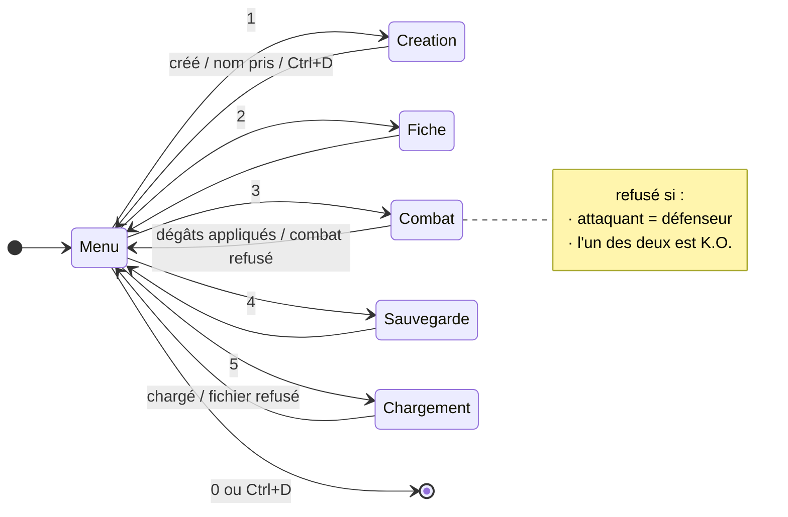
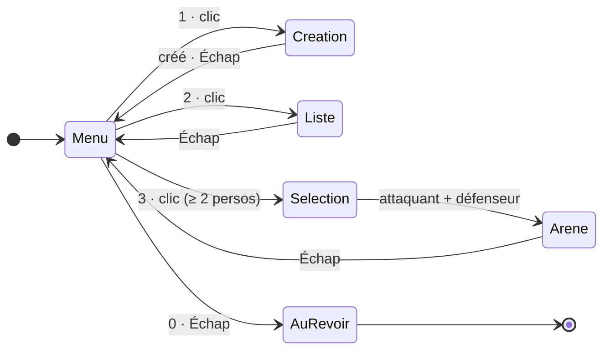
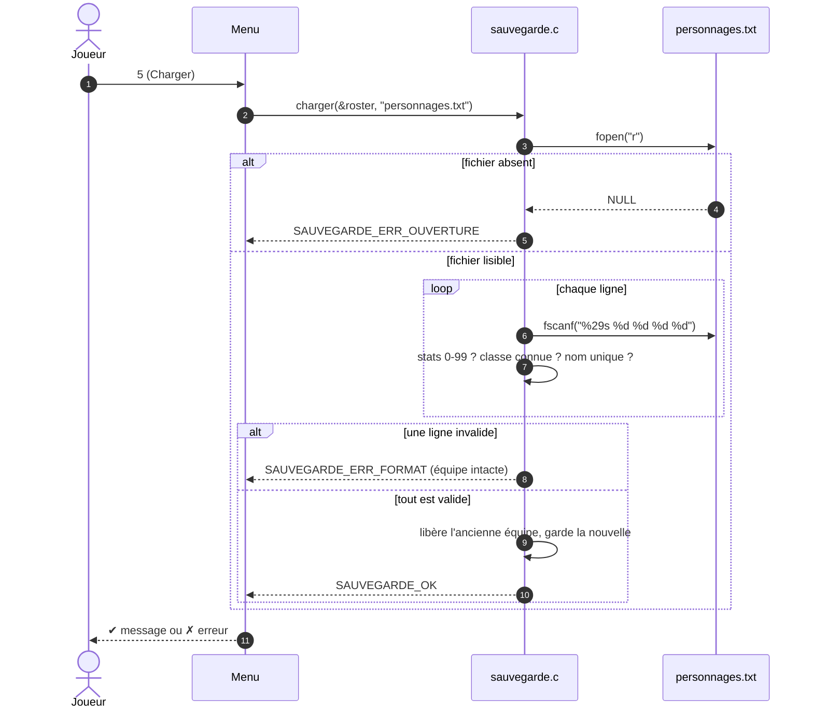
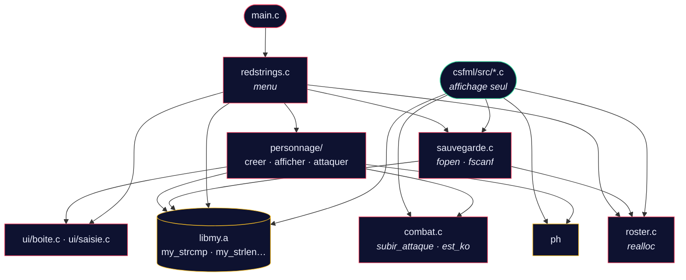
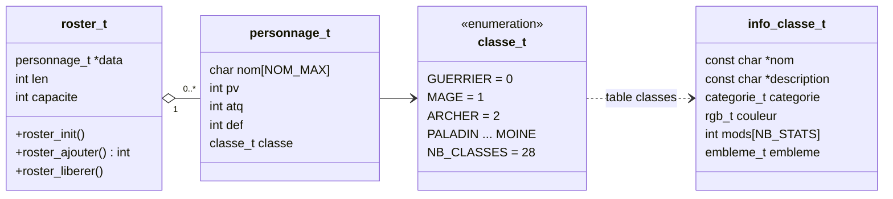
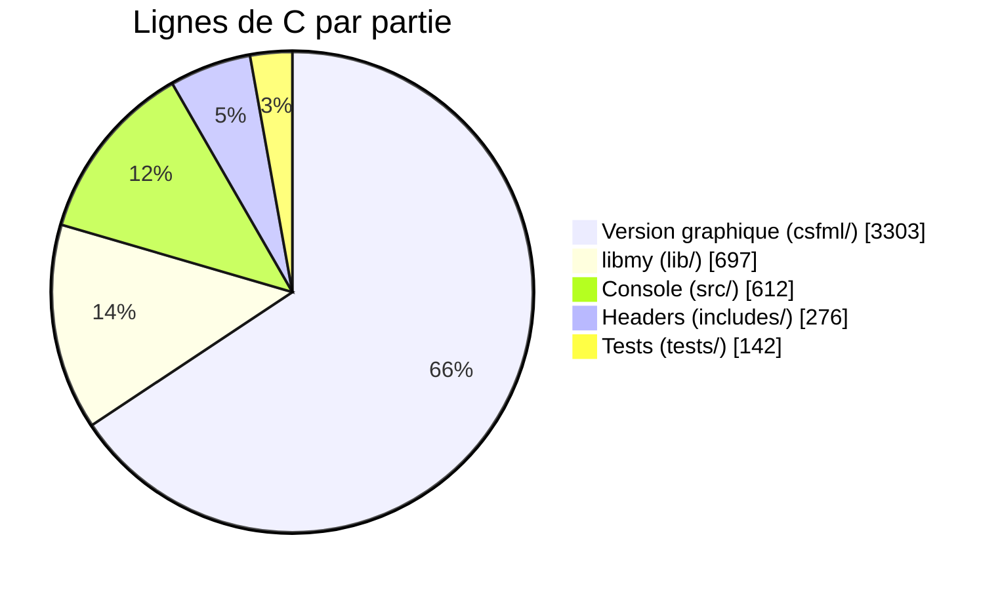
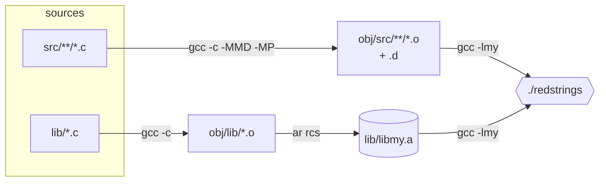
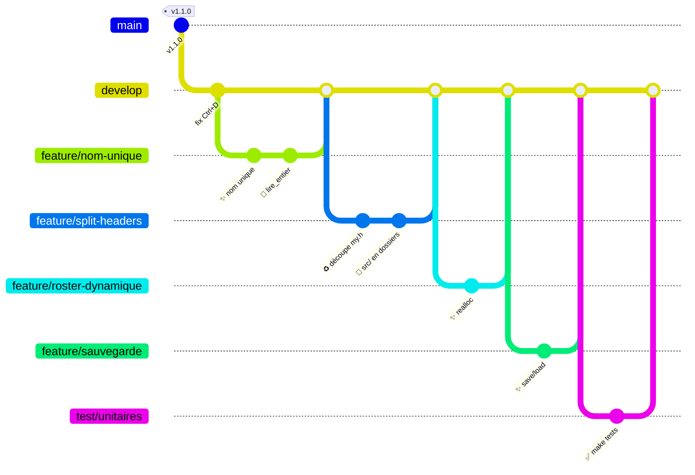

<div align="center">


<br/>

[](#%EF%B8%8F-architecture)
[](#-le-makefile)
[](#%EF%B8%8F-la-version-graphique-csfml)
[](#-tests)
[](#)

**Un jeu de combat au tour par tour, écrit en C pur.**<br/>
<sub>Deux interfaces · un même moteur · zéro fuite mémoire · une bibliothèque maison <code>libmy.a</code></sub>

<br/>

[**Démarrage**](#-démarrage-en-30-secondes) ·
[**Jouer**](#-jouer-version-console) ·
[**Combat**](#%EF%B8%8F-les-règles-du-combat) ·
[**Architecture**](#%EF%B8%8F-architecture) ·
[**Makefile**](#-le-makefile) ·
[**Tests**](#-tests) ·
[**Sécurité**](#-robustesse--sécurité) ·
[**Conventions**](#-conventions)

</div>


## 🎬 Le projet en une image

<div align="center">

<sub><i>Session rejouée à l'identique : compilation → création → fiche → combat. Les valeurs sont celles que le programme affiche vraiment.</i></sub>
</div>

<br/>

**RedStrings** est le projet fil rouge du module *Langage C avancé* (ESGI 2ᵉ année).
On crée des personnages (nom, points de vie, attaque, défense, classe), on consulte leur fiche,
puis on les fait s'affronter. La défense réduit les dégâts en pourcentage, et un personnage à 0 PV est K.O.

<table>
<tr>
<td width="50%" valign="top">

### 🖥️ Version console &nbsp;`./redstrings`
- Menu coloré dessiné en boîtes Unicode
- Personnages **illimités** (tableau dynamique `realloc`)
- **Sauvegarde / chargement** dans `personnages.txt`
- Chaque saisie est **vérifiée** (Ctrl+D, `12abc`, débordement…)
- Testée avec `assert` + AddressSanitizer

</td>
<td width="50%" valign="top">

### 🎨 Version graphique &nbsp;`./redstrings_csfml`
- Fenêtre 1280×720, VSync, souris + clavier
- Aperçu **en direct** pendant la création
- Recherche par nom, cartes, fiches en modale
- Arène animée : tours, particules, K.O., inversion des rôles
- Même formule de dégâts que la console

</td>
</tr>
</table>


## 🚀 Démarrage en 30 secondes

```bash
git clone https://github.com/Vylllixis/RedStrings.git
cd RedStrings
make            # compile ./redstrings (et lib/libmy.a au passage)
./redstrings    # c'est parti
```

<details>
<summary><b>🎨 Lancer la version graphique (CSFML)</b></summary>

<br/>

La version graphique a besoin de la bibliothèque **CSFML** (le binding C de SFML).

| Système | Commande |
|---|---|
| 🐧 Debian / Ubuntu | `sudo apt install libcsfml-dev` |
| 🎩 Fedora | `sudo dnf install CSFML-devel` |
| 🏔️ Arch | `sudo pacman -S csfml` |

```bash
make csfml            # compile ./redstrings_csfml
./redstrings_csfml
```

> [!TIP]
> Si CSFML manque, `make csfml` s'arrête tout de suite avec un message clair au lieu d'une erreur de compilation :
> `✗ CSFML introuvable, installe-la avec : sudo apt install libcsfml-dev`

> [!NOTE]
> Les polices (Noto Sans, DejaVu Sans) sont cherchées à côté de l'exécutable, puis depuis le dossier courant : tu peux lancer le jeu depuis n'importe où dans le projet.

</details>

<details>
<summary><b>🧰 Prérequis</b></summary>

<br/>

| Outil | Pourquoi | Vérifier |
|---|---|---|
| `gcc` (C11) | compilation | `gcc --version` |
| `make` | construction | `make --version` |
| `ar` | archive `libmy.a` | `ar --version` |
| CSFML *(optionnel)* | version graphique | `ls /usr/include/SFML/Graphics.h` |

</details>


## 🎮 Jouer (version console)

```
╭────────────────────────────────────╮
│  ✦ Menu principal                  │
├────────────────────────────────────┤
│  1  Ajouter un personnage          │
│  2  Afficher un personnage         │
│  3  Combat                         │
│  4  Sauvegarder                    │
│  5  Charger                        │
│  0  Quitter                        │
╰────────────────────────────────────╯
  Choix (0-5) ›
```

| Touche | Action | Ce qui se passe |
|:---:|---|---|
| <kbd>1</kbd> | **Ajouter** | Nom → PV → Attaque → Défense → Classe. Le nom doit être unique. |
| <kbd>2</kbd> | **Afficher** | Fiche avec barres de stats colorées. |
| <kbd>3</kbd> | **Combat** | Attaquant puis défenseur : les dégâts sont calculés et appliqués. |
| <kbd>4</kbd> | **Sauvegarder** | Écrit tous les personnages dans `personnages.txt`. |
| <kbd>5</kbd> | **Charger** | Remplace l'équipe par le contenu de `personnages.txt`. |
| <kbd>0</kbd> ou <kbd>Ctrl</kbd>+<kbd>D</kbd> | **Quitter** | Libère la mémoire, puis « À bientôt ! ». |

<details>
<summary><b>📋 Ce que le jeu accepte (et refuse)</b></summary>

<br/>

| Saisie | Règle | Si c'est faux |
|---|---|---|
| Nom | 1 mot, 29 caractères max, **unique** | `✗ Ce nom est déjà pris` |
| PV / Attaque / Défense | entier de **0 à 99** | `✗ Valeur invalide`, puis la question est reposée |
| Classe | 1, 2 ou 3 | `✗ Valeur invalide` |
| `12abc`, `abc`, `99999999999` | refusés : `strtol` contrôle **toute** la ligne | `✗ Valeur invalide` |
| <kbd>Ctrl</kbd>+<kbd>D</kbd> pendant une création | la création est annulée | `✗ Saisie interrompue` |

</details>

<details>
<summary><b>🎥 Une partie complète, pas à pas</b></summary>

<br/>

```text
  Choix (0-5) › 1
  Nom › Aragorn
  Points de vie (0-99) › 80
  Attaque       (0-99) › 60
  Défense       (0-99) › 30
  Choix (1-3) › 1
  ✔ Aragorn a été créé !

  Choix (0-5) › 1
  Nom › Merlin            … 55 / 85 / 15, classe 2 (Mage)
  ✔ Merlin a été créé !

  Choix (0-5) › 3
  Attaquant › Merlin
  Défenseur › Aragorn
╭────────────────────────────────────╮
│  ⚔ Merlin attaque Aragorn          │
├────────────────────────────────────┤
│  Attaque      85                   │
│  Réduction    -30%                 │
│  Dégâts       59                   │
│  PV restants  21                   │
╰────────────────────────────────────╯

  Choix (0-5) › 4
  ✔ 2 personnage(s) sauvegardé(s) dans personnages.txt
```

</details>

### 🧭 Le menu, vu comme une machine à états




## 🖼️ La version graphique (CSFML)



| Écran | Clavier | Souris |
|---|---|---|
| **Menu** | <kbd>↑</kbd> <kbd>↓</kbd> choisir · <kbd>Entrée</kbd> valider · <kbd>1</kbd> <kbd>2</kbd> <kbd>3</kbd> raccourcis · <kbd>4</kbd> sauvegarder · <kbd>5</kbd> charger · <kbd>0</kbd>/<kbd>Échap</kbd> quitter | survol pour choisir, clic pour valider |
| **Création** | <kbd>Tab</kbd> / <kbd>↑</kbd> <kbd>↓</kbd> naviguer · <kbd>←</kbd> <kbd>→</kbd> ajuster, ou changer de classe · <kbd>Maj</kbd> = ×10, ou catégorie suivante · <kbd>Entrée</kbd> créer | glissières, onglets de catégorie, grille de classes, bouton |
| **Personnages** | taper pour rechercher · <kbd>Entrée</kbd> ouvrir · <kbd>←</kbd> <kbd>→</kbd> changer de fiche | clic sur une carte |
| **Sélection** | <kbd>Échap</kbd> annule l'attaquant, puis revient au menu | clic : attaquant, puis défenseur |
| **Arène** | <kbd>Espace</kbd>/<kbd>Entrée</kbd> attaquer · <kbd>R</kbd> inverser les rôles · <kbd>Échap</kbd> menu | boutons *Attaquer*, *Inverser*, *Menu* |

> [!NOTE]
> **Un seul moteur pour deux interfaces.** `csfml/src/` ne contient que l'affichage : la version graphique compile directement `personnage.c`, `combat.c`, `roster.c` et `sauvegarde.c` depuis `src/personnage/`. Même table de classes, mêmes bornes (`STAT_MIN`, `STAT_MAX`), même calcul de dégâts (`subir_attaque`), même `roster_t`, même fichier `personnages.txt` : une équipe sauvegardée dans la console se recharge dans la fenêtre, et inversement.

> [!WARNING]
> L'écran n'a de place que pour **10 cartes** : la version graphique refuse de créer un 11ᵉ personnage, et refuse de charger un fichier qui en contient plus (l'équipe actuelle n'est alors pas touchée).

<details>
<summary><b>✨ Ce qui rend l'interface vivante</b></summary>

<br/>

**Direction artistique.** Toutes les surfaces partagent la même silhouette : deux coins coupés (haut-gauche, bas-droite) et des crochets lumineux sur les deux autres. Le rouge porte la marque et le combat, le cyan les actions, le vert les PV, le bleu la défense. Les composants communs sont dans `csfml/src/hud.c` (`panneau`, `crochets`, `titre_section`, `hexagone`, `radar_stats`, `touche_clavier`…).

| Effet | Où | Comment |
|---|---|---|
| Profondeur du fond | tous les écrans | étoiles lointaines, halos, sol quadrillé en perspective, fils rouges parcourus d'impulsions |
| Hologramme de classe | aperçu de la création | socle, cône de projection, anneaux, aura propre à la catégorie (lames, orbite d'astres, réticule, croix de soutien) |
| Radar des statistiques | aperçu de la création | triangle PV / attaque / défense, animé avec les vraies valeurs |
| Catalogue de classes | création | 4 onglets de catégorie, grille de tuiles colorées, 20 emblèmes vectoriels (`emblemes.c`), onde de choc et fondu de couleur au changement de classe |
| Mouvements organiques | boutons, cartes | ressorts amortis (`ressort_t`) |
| Courbes d'animation | entrées / sorties de scène | `sortie_cubique`, `entree_cubique`, `sortie_rebond` |
| Particules | création, impacts, K.O. | jusqu'à 900 particules avec gravité |
| Poussière d'ambiance | fond | 70 grains qui flottent, 160 étoiles qui scintillent |
| Notifications | coin de l'écran | toasts empilables (4 max) |
| Halo lumineux | cartes, titres | texture de dégradé radial générée au lancement |

</details>


## ⚔️ Les règles du combat

<div align="center">

</div>

La défense est un **pourcentage de réduction**. Le calcul est fait en entiers (la division tronque) :

$$
\text{dégâts} = \max\left(0,\ \left\lfloor \frac{\text{attaque} \times (100 - \text{défense})}{100} \right\rfloor\right)
\qquad
\text{PV}_{\text{cible}} = \max(0,\ \text{PV}_{\text{cible}} - \text{dégâts})
$$

| Attaque | Défense | Calcul | Dégâts |
|:---:|:---:|---|:---:|
| 85 | 30 | 85 × 70 / 100 = 59,5 → **59** | 🟥 59 |
| 40 | 50 | 40 × 50 / 100 | 🟧 20 |
| 99 | 0 | aucune réduction | 🟥 99 |
| 60 | 99 | 60 × 1 / 100 = 0,6 → **0** | ⬜ 0 |

### 🧬 Les 28 classes

Chaque classe vient d'**une seule ligne** de la table `classes[]` ([`personnage.c`](src/personnage/personnage.c)) : nom, description, catégorie, couleur RGB, modificateurs et emblème. La console (couleur ANSI 24 bits), la fenêtre CSFML et la logique de jeu lisent toutes cette même table.

> [!NOTE]
> **Les modificateurs s'ajoutent aux statistiques de base choisies**, une seule fois à la création, bornés entre 0 et 99. Leur somme vaut toujours 0 : une classe gagne d'un côté ce qu'elle perd de l'autre (vérifié par `make tests`). Le combat lui-même ne change pas : il utilise les statistiques finales.

<details open>
<summary><b>⚔️ Corps à corps — 8 classes</b></summary>

| Id | Classe | Couleur | PV | ATQ | DEF | Description |
|:---:|---|:---:|:---:|:---:|:---:|---|
| 0 | **Guerrier** |  `#ef4444` | ±0 | ±0 | ±0 | Combattant polyvalent |
| 3 | **Paladin** |  `#eee527` | **+10** | −15 | **+5** | Rempart sacré en armure lourde |
| 4 | **Berserker** |  `#cb285b` | **+5** | **+15** | −20 | Rage aveugle, frappe sans garde |
| 5 | **Chevalier noir** |  `#8657f1` | −10 | **+5** | **+5** | Lame maudite, armure d'ombre |
| 6 | **Samouraï** |  `#fb6e0f` | −5 | **+10** | −5 | Maître du sabre, coup décisif |
| 7 | **Duelliste** |  `#e47f85` | −10 | **+10** | ±0 | Escrime vive et précise |
| 8 | **Lancier** |  `#edf3fc` | ±0 | **+5** | −5 | Allonge et charge brutale |
| 9 | **Gladiateur** |  `#a1774b` | **+10** | **+5** | −15 | Champion de l'arène |

</details>

<details>
<summary><b>✨ Magie — 8 classes</b></summary>

| Id | Classe | Couleur | PV | ATQ | DEF | Description |
|:---:|---|:---:|:---:|:---:|:---:|---|
| 1 | **Mage** |  `#d946ef` | −10 | **+15** | −5 | Arcanes offensives |
| 10 | **Archimage** |  `#2964d8` | −15 | **+20** | −5 | Maîtrise absolue des arcanes |
| 11 | **Élémentaliste** |  `#16d8f4` | −5 | **+15** | −10 | Feu, glace et foudre |
| 12 | **Nécromancien** |  `#9afb5f` | **+5** | **+5** | −10 | Draine la vie des vivants |
| 13 | **Invocateur** |  `#9996eb` | **+5** | ±0 | −5 | Appelle des esprits alliés |
| 14 | **Druide** |  `#44862a` | **+5** | −5 | ±0 | Force de la nature |
| 15 | **Illusionniste** |  `#fab3ec` | −5 | ±0 | **+5** | Trompe l'œil et l'esprit |
| 16 | **Chronomancien** |  `#97b7de` | −10 | **+5** | **+5** | Plie le cours du temps |

</details>

<details>
<summary><b>🏹 Distance — 6 classes</b></summary>

| Id | Classe | Couleur | PV | ATQ | DEF | Description |
|:---:|---|:---:|:---:|:---:|:---:|---|
| 2 | **Archer** |  `#22c55e` | −5 | **+10** | −5 | Tir rapide à distance |
| 17 | **Chasseur** |  `#91922d` | ±0 | **+10** | −10 | Pisteur des terres sauvages |
| 18 | **Tireur d'élite** |  `#dde37c` | −15 | **+20** | −5 | Un tir, une cible |
| 19 | **Assassin** |  `#787279` | −20 | **+20** | ±0 | Frappe dans l'ombre |
| 20 | **Ombrelame** |  `#a616fe` | −5 | **+5** | ±0 | Lame tissée d'ombre |
| 21 | **Corsaire** |  `#07aafa` | **+10** | ±0 | −10 | Pirate des mers lointaines |

</details>

<details>
<summary><b>🛡️ Soutien — 6 classes</b></summary>

| Id | Classe | Couleur | PV | ATQ | DEF | Description |
|:---:|---|:---:|:---:|:---:|:---:|---|
| 22 | **Prêtre** |  `#efdcae` | **+15** | −15 | ±0 | Foi inébranlable |
| 23 | **Barde** |  `#c5529c` | ±0 | −5 | **+5** | Chants qui galvanisent |
| 24 | **Alchimiste** |  `#71f4d9` | **+10** | −5 | −5 | Potions et mixtures |
| 25 | **Ingénieur** |  `#f4b269` | −5 | −5 | **+10** | Machines et tourelles |
| 26 | **Gardien** |  `#32719e` | **+5** | −20 | **+15** | Mur vivant, défense ultime |
| 27 | **Moine** |  `#f0b11d` | **+5** | **+10** | −15 | Corps et esprit en harmonie |

</details>

> [!TIP]
> **Ajouter une classe** : une valeur juste avant `NB_CLASSES` dans l'`enum` (jamais au milieu : l'identifiant est écrit dans les sauvegardes), puis une ligne dans `classes[]`. Les listes de la console, les onglets et la grille de la fenêtre, l'aperçu et les tests la prennent en compte sans autre modification.

> [!IMPORTANT]
> **Trois règles protègent le combat :** un personnage ne peut pas s'attaquer lui-même, un personnage K.O. (0 PV) ne peut ni attaquer ni être attaqué, et les PV ne descendent jamais sous 0.


## 💾 Sauvegarde

Un personnage par ligne, au format texte (`nom pv attaque défense classe`, la classe étant l'identifiant de 0 à 27 du tableau ci-dessus) :

```text
Aragorn 80 60 30 0
Merlin 55 85 15 1
```

Le chargement est **transactionnel** : tout le fichier est lu dans un roster temporaire, puis il remplace l'équipe seulement s'il est entièrement valide.



| Code de retour | Message affiché |
|---|---|
| `SAUVEGARDE_OK` | `✔ N personnage(s) chargé(s)` / `sauvegardé(s)` |
| `SAUVEGARDE_ERR_OUVERTURE` | `✗ Impossible d'ouvrir le fichier` |
| `SAUVEGARDE_ERR_ECRITURE` | `✗ Erreur pendant l'écriture` (`fprintf` ou `fclose` a échoué) |
| `SAUVEGARDE_ERR_FORMAT` | `✗ Fichier corrompu : chargement annulé` |
| `SAUVEGARDE_ERR_MEMOIRE` | `✗ Mémoire insuffisante` |


## 🏗️ Architecture

```text
RedStrings/
├── 📁 includes/              ← un header = un thème
│   ├── personnage.h          personnage_t, classe_t, NOM_MAX, STAT_MIN/MAX
│   ├── roster.h              tableau dynamique de personnages
│   ├── sauvegarde.h          sauvegarder / charger + codes d'erreur
│   ├── boite.h               boîtes Unicode, alignement des libellés
│   ├── saisie.h              lire_ligne, lire_entier, vider_buffer
│   ├── couleurs.h            codes ANSI (ROUGE, VERT, GRAS…)
│   ├── my.h · my_string.h    prototypes de libmy.a
│   └── redstrings.h          point d'entrée du menu
├── 📁 src/
│   ├── main.c                return redstrings();
│   ├── redstrings.c          boucle du menu
│   ├── 📁 personnage/         moteur partagé : personnage · combat · roster · sauvegarde
│   │                          affichage console : creer · afficher · attaquer
│   └── 📁 ui/                 boite.c · saisie.c
├── 📁 lib/                   40 fonctions maison → libmy.a
├── 📁 csfml/                 version graphique (src/, include/gui.h, assets/fonts/)
├── 📁 tests/                 tests.c (assert)
└── Makefile
```

### 🔗 Qui dépend de qui



### 🧬 Les structures de données



<details>
<summary><b>📈 Comment le roster grandit (realloc ×2)</b></summary>

<br/>

```text
ajout n°  1   capacité  4   [■□□□]
ajout n°  5   capacité  8   [■■■■■□□□]                    ← realloc
ajout n°  9   capacité 16   [■■■■■■■■■□□□□□□□]            ← realloc
ajout n° 17   capacité 32   …
```

```c
tmp = realloc(r->data, (size_t)nouvelle * sizeof(*tmp));
if (tmp == NULL)
    return -1;      // r->data reste valide : pas de fuite
r->data = tmp;
```

> [!WARNING]
> Ne jamais écrire `r->data = realloc(r->data, …)` : si `realloc` échoue, il renvoie `NULL` et l'ancien tableau est perdu. C'est une fuite mémoire.

</details>

<details>
<summary><b>📊 Répartition du code</b></summary>

<br/>



</details>


## 🔨 Le Makefile

| Commande | Résultat |
|---|---|
| `make` | compile `./redstrings` (et `lib/libmy.a` si besoin) |
| `make lib` | compile seulement `lib/libmy.a` |
| `make debug` | `./redstrings_debug` avec `-g3 -O0 -fsanitize=address,undefined` |
| `make tests` | compile et lance les tests unitaires (avec les sanitizers) |
| `make csfml` | compile `./redstrings_csfml` |
| `make clean` | supprime les `.o` |
| `make fclean` | supprime aussi les exécutables et `libmy.a` |
| `make re` | `fclean` puis `make` |
| `make build` | comme `re`, mais ne garde que les exécutables |
| `make V=1` | affiche les commandes complètes au lieu des lignes courtes |
| `make help` | liste toutes ces règles |



<details>
<summary><b>🚩 Les flags, un par un</b></summary>

<br/>

```makefile
CFLAGS = -std=c11 -Wall -Wextra -Werror -pedantic -Wshadow -Wmissing-prototypes
```

| Flag | Ce qu'il apporte |
|---|---|
| `-std=c11` | fixe la version du C : le code compile pareil partout |
| `-Wall -Wextra` | la grande majorité des avertissements utiles |
| `-Werror` | un avertissement **bloque** la compilation |
| `-pedantic` | refuse les extensions non standard de gcc |
| `-Wshadow` | signale une variable qui en cache une autre |
| `-Wmissing-prototypes` | toute fonction publique doit être déclarée dans un `.h` |
| `-MMD -MP` | modifier un `.h` recompile tous les `.c` qui l'incluent |

</details>

> [!TIP]
> `boite_ligne()` et `boite_champ()` sont déclarées avec `__attribute__((format(printf, …)))` : gcc vérifie leurs formats comme ceux de `printf`. Un `%d` avec une chaîne devient une **erreur de compilation**, au lieu d'un affichage faux en pleine partie.


## 🧪 Tests

```bash
make tests
```

`tests/tests.c` est compilé avec **tout le jeu sauf `main.c`**, plus AddressSanitizer et UBSan : un débordement, un comportement indéfini **ou une fuite mémoire** fait échouer les tests.

| Domaine | Ce qui est vérifié |
|---|---|
| `my_strcmp` | égalité, différence, préfixe, chaînes vides |
| Catalogue | ≥ 20 classes, noms uniques, descriptions courtes, catégories et emblèmes valides, modificateurs bornés de somme nulle, couleurs distinctes deux à deux |
| Modificateurs | Berserker 50/50/50 → 55/65/30, bornes 0 et 99 respectées |
| Compatibilité | une sauvegarde à 3 classes se relit, un identifiant hors catalogue est refusé |
| `calculer_degats` | 40 × 50 % = 20 · défense 100 → 0 dégât |
| `attaquer` | les PV diminuent et ne passent **jamais sous 0** |
| `trouver_personnage` | trouvé, absent, sensible à la casse, tableau vide |
| `roster_t` | 100 ajouts d'affilée, ordre conservé, libération complète |
| Sauvegarde | aller-retour fichier → mémoire identique |
| Chargement refusé | fichier absent · classe inconnue · stat > 99 · nom en double · ligne tronquée · texte au lieu d'un nombre (et l'équipe reste intacte) |


## 🔐 Robustesse & sécurité

Le projet a été audité point par point (voir [`AMELIORATIONS.md`](AMELIORATIONS.md)). Chaque problème a été **reproduit**, puis corrigé :

| | Avant | Après |
|:---:|---|---|
| 🔴 | <kbd>Ctrl</kbd>+<kbd>D</kbd> au menu → **boucle infinie** | `lire_entier` renvoie `-1` sur fin d'entrée → sortie propre |
| 🔴 | `scanf` du nom jamais vérifié → nom **non initialisé** | retour vérifié, tampon initialisé |
| 🟠 | `scanf("%d")` acceptait `12abc` et pouvait déborder | `fgets` + `strtol` : toute la ligne doit être un nombre, dans les bornes |
| 🟠 | deux personnages pouvaient porter **le même nom** | `trouver_personnage` avant chaque création |
| 🟡 | `sprintf` sans limite dans les barres de stats | `snprintf` avec la taille du tampon |
| 🟠 | un personnage pouvait **s'attaquer lui-même** | combat refusé |
| 🟡 | un personnage **mort** pouvait encore attaquer | combat refusé |
| 🔴 | modifier un `.h` ne recompilait rien | dépendances `-MMD -MP` |
| 🟢 | 10 personnages maximum | `roster_t` + `realloc` |

```diff
- int ret = scanf("%d", &choix);          // "12abc" → 12, Ctrl+D → boucle infinie
+ if (lire_entier("Choix", 0, 5, &choix) == -1)
+     choix = 0;                           // fin d'entrée : on quitte proprement
```


## 📚 libmy.a

Une bibliothèque de **40 fonctions** réécrites à la main, compilée en archive statique et liée aux deux versions du jeu. Le code n'utilise pas `strlen`, `strcmp` ou `strcpy` de la libc : il passe par `my_strlen`, `my_strcmp` et `my_strcpy`.

<details>
<summary><b>🔤 Chaînes — <code>my_string.h</code> (18 fonctions)</b></summary>

<br/>

| Famille | Fonctions |
|---|---|
| Longueur, comparaison | `my_strlen` · `my_strcmp` · `my_strncmp` · `my_strstr` |
| Copie, concaténation | `my_strcpy` · `my_strncpy` · `my_strcat` · `my_strncat` · `my_strdup` |
| Transformation | `my_revstr` · `my_strupcase` · `my_strlowcase` · `my_strcapitalize` |
| Tests (1 = vrai) | `my_str_isalpha` · `my_str_islower` · `my_str_isupper` · `my_str_isnum` · `my_str_isprintable` |

</details>

<details>
<summary><b>🔢 Affichage, nombres, tableaux — <code>my.h</code> (22 fonctions)</b></summary>

<br/>

| Famille | Fonctions |
|---|---|
| Affichage | `my_putchar` · `my_putstr` · `my_put_nbr` · `my_showstr` · `my_showmem` |
| Nombres | `isneg` · `my_getnbr` · `my_compute_power_rec` · `my_compute_square_root` · `my_is_prime` · `my_find_prime_sup` · `my_swap` · `my_sort_int_array` |
| Tableaux & paramètres | `my_arraylen` · `my_arraystrlen` · `my_str_to_word_array` · `my_show_word_array` · `my_swap_params` · `my_print_params` · `my_rev_params` · `my_sort_params` · `concat_params` |

</details>


## 📐 Conventions

<table>
<tr><td valign="top" width="50%">

#### Nommage

| Élément | Style | Exemple |
|---|---|---|
| Fonctions | `snake_case` | `creer_personnage` |
| Variables, champs | `snake_case` | `nb_persos`, `p->atq` |
| Types | `snake_case_t` | `roster_t` |
| Macros, `enum` | `MAJUSCULES` | `STAT_MAX`, `MAGE` |
| Fichiers | `snake_case.c` | `afficher_personnage.c` |
| Langue | français | `trouver_personnage` |

</td><td valign="top" width="50%">

#### Commits (gitmoji)

| | Type | Usage |
|:---:|---|---|
| ✨ | `feat` | nouvelle fonctionnalité |
| 🐛 | `fix` | correction de bug |
| ♻️ | `refactor` | restructuration sans changer le comportement |
| ✅ | `test` | tests |
| 🔨 | `build` | Makefile |
| 📝 | `docs` | documentation |
| 🔀 | `merge` | fusion d'une branche |
| 🔖 | `chore(release)` | nouvelle version |

</td></tr>
</table>

Le dépôt suit **git flow** : chaque changement vit sur sa branche, puis est fusionné dans `develop` avec `--no-ff`. `main` ne reçoit que les versions publiées (`v0.1.0` → `v1.1.0`).




## 🗺️ Feuille de route

- [x] Menu console, création, fiche, combat
- [x] Version graphique CSFML
- [x] Bibliothèque `libmy.a`
- [x] Saisies sécurisées, nom unique, règles de combat
- [x] Headers découpés par thème, `src/` rangé en sous-dossiers
- [x] Personnages illimités (`realloc`)
- [x] Sauvegarde / chargement
- [x] Tests unitaires + sanitizers
- [ ] Documentation Doxygen (`Doxyfile`, `make doc`)
- [x] Version graphique branchée sur le moteur commun (roster, combat, classes, sauvegarde)
- [ ] Version graphique : faire défiler les cartes pour dépasser 10 personnages
- [x] Publier la version `v1.2.0` sur `main`


## ❓ FAQ

<details>
<summary><b>« make: Rien à faire pour all » alors que j'ai modifié un header ?</b></summary>
<br/>
Ça ne devrait plus arriver : gcc génère un fichier <code>.d</code> par objet (<code>-MMD -MP</code>) et le Makefile le charge. Si tu as gardé un vieux dossier <code>obj/</code>, fais un <code>make re</code> une fois.
</details>

<details>
<summary><b>Où est mon fichier de sauvegarde ?</b></summary>
<br/>
Dans le dossier depuis lequel tu as lancé <code>./redstrings</code> : <code>personnages.txt</code>. Il est ignoré par git.
</details>

<details>
<summary><b>Le chargement dit « Fichier corrompu » : j'ai perdu mon équipe ?</b></summary>
<br/>
Non. Le fichier est lu dans un roster temporaire : en cas d'erreur, ton équipe actuelle n'est pas touchée.
</details>

<details>
<summary><b>Comment traquer un bug mémoire ?</b></summary>
<br/>

```bash
make debug
./redstrings_debug        # s'arrête avec la ligne exacte du problème
gdb ./redstrings_debug    # ou pas à pas
```

</details>

<details>
<summary><b>Pourquoi des noms sans espace ?</b></summary>
<br/>
Le nom sert d'identifiant (recherche, combat, fichier de sauvegarde). Il est lu avec <code>scanf("%29s")</code>, qui s'arrête au premier espace : 29 caractères maximum, plus le <code>'\0'</code>, pour tenir dans <code>char nom[30]</code>.
</details>

<br/>

<div align="center">


<sub>Projet fil rouge · <b>Langage C avancé</b> · ESGI 2ᵉ année · 2026</sub><br/>
<sub>Fait avec ❤️, <code>gcc -Werror</code> et beaucoup de <code>printf</code> par <a href="https://github.com/Vylllixis"><b>Vyllixis</b></a></sub>

</div>
