<div align="center">


<br/>

[](#architecture)
[](#csfml)
[](#personnages)
[](#tests)
[](#concept)

**Un jeu de combat tactique en équipe, au tour par tour, écrit en C pur.**<br/>
<sub>Un moteur sans affichage · deux interfaces (terminal et fenêtre CSFML) · 28 classes · une bibliothèque maison <code>libmy.a</code></sub>

<br/>

[**Concept**](#concept) ·
[**Identité**](#identite) ·
[**Personnages**](#personnages) ·
[**Combat**](#combat) ·
[**Mécaniques**](#mecaniques) ·
[**Choix techniques**](#choix-techniques) ·
[**Architecture**](#architecture) ·
[**Installer**](#installer) ·
[**Contribuer**](#contribuer)

</div>

> [!NOTE]
> **Comment lire les images de cette page.** Les images marquées 🎥 **capture réelle** ont été enregistrées image par image depuis `./redstrings_csfml`, sans retouche. Les images marquées ✏️ **illustration** sont des animations SVG générées par [`generer_svg.py`](.github/readme/outils/generer_svg.py) : elles **lisent** le catalogue dans `src/personnage/personnage.c`, et leurs nombres viennent des tests unitaires ou d'une vraie session. Ce sont des schémas, pas des captures du jeu.


<a id="concept"></a>

## 01 · Le concept

**RedStrings** est le projet fil rouge du module *Langage C avancé* (ESGI, 2ᵉ année). On crée des personnages (nom, PV, attaque, défense, soin, et une classe parmi 28), on compose **deux équipes de 1 à 4**, puis on affronte l'ordinateur au tour par tour : chaque combattant **attaque**, **soigne** un allié ou **se met en garde**.

<div align="center">
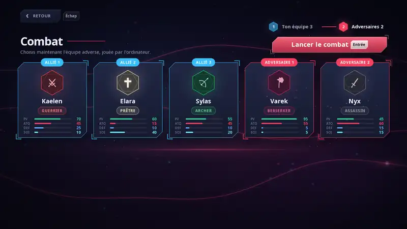
<sub>🎥 <b>Capture réelle</b>, <code>./redstrings_csfml</code>, 1280×720 réduit à 800 px. Ton équipe au premier plan à gauche, l'adversaire plus petit et plus loin en haut à droite. On y voit, dans l'ordre : une attaque, la riposte de l'ordinateur, un soin, un K.O., puis la contre-attaque.</sub>
</div>

<br/>

<table>
<tr>
<td width="50%" valign="top">

### 🖥️ Dans le terminal &nbsp;`./redstrings`

- Menu coloré, dessiné en boîtes Unicode
- Fiches de personnage avec la couleur de la classe (ANSI 24 bits)
- Combat en équipe : plateau, barres de PV, garde, journal
- Personnages **illimités** (tableau dynamique `realloc`)
- **Sauvegarde / chargement** dans `personnages.txt`
- Chaque saisie est **vérifiée** (<kbd>Ctrl</kbd>+<kbd>D</kbd>, `12abc`, débordement…)

</td>
<td width="50%" valign="top">

<a id="csfml"></a>

### 🎨 Dans la fenêtre &nbsp;`./redstrings_csfml`

- 1280×720, VSync, souris et clavier
- Création avec **aperçu en direct** (hologramme, radar 4 axes)
- Composition des équipes sur des cartes
- **Arène** en perspective : impacts, soins, gardes et K.O. animés
- Ordre des tours, journal et PV mis à jour **à l'impact**
- Même moteur, même fichier de sauvegarde que la console

</td>
</tr>
</table>


<a id="identite"></a>

## 02 · L'identité visuelle

Le nom **RedStrings** vient d'une image : des **fils rouges** qui relient les personnages entre eux. On les retrouve partout, dans le fond de la fenêtre, sous le logo et dans les diagrammes de cette page.

<div align="center">
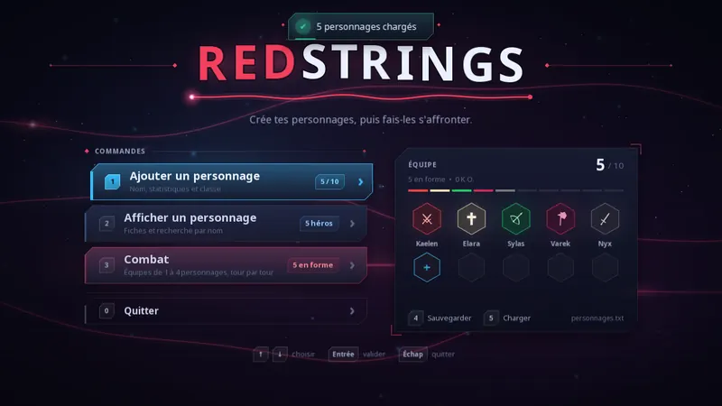
<sub>🎥 <b>Capture réelle</b> du menu, juste après le chargement de <code>personnages.txt</code>.</sub>
</div>

<br/>

| Couleur | Rôle | Constante (`csfml/include/gui_config.h`) |
|---|---|---|
|  `#f43f5e` | la marque, les fils, l'adversaire, l'attaque | `C_ROUGE` |
|  `#38bdf8` | ton équipe, les actions, le focus | `C_CYAN` |
|  `#34d399` | les points de vie | `C_VERT` |
|  `#60a5fa` | la défense et la garde | `C_BLEU` |
|  `#67e8f9` | le soin | `C_SOIN` |
|  `#090b18` | le fond, un bleu nuit presque noir | `C_FOND` |

**Une seule silhouette.** Toutes les surfaces ont deux coins coupés (haut-gauche, bas-droite) et des crochets lumineux sur les deux autres. Les composants communs vivent dans `csfml/src/rendu/hud.c` : `panneau`, `crochets`, `titre_section`, `hexagone`, `radar_stats`, `touche_clavier`…

<details>
<summary><b>✨ Ce qui rend l'interface vivante</b></summary>

<br/>

| Effet | Où | Comment |
|---|---|---|
| Profondeur du fond | tous les écrans | 160 étoiles lointaines, halos, sol quadrillé en perspective, fils rouges parcourus d'impulsions |
| Hologramme de classe | aperçu de la création | socle, cône de projection, anneaux, aura propre à la catégorie |
| Radar des statistiques | aperçu de la création | losange PV / ATQ / DEF / SOIN, animé avec les vraies valeurs finales |
| Catalogue | création | 4 onglets de catégorie, grille de tuiles colorées, 20 emblèmes vectoriels (`emblemes.c`) |
| Mouvements organiques | boutons, cartes | ressorts amortis (`ressort_t`) |
| Courbes d'animation | entrées et sorties de scène | `sortie_cubique`, `entree_cubique`, `sortie_rebond` |
| Particules | création, impacts, K.O. | jusqu'à 900 particules (`MAX_PARTICULES`), avec gravité |
| Poussière d'ambiance | fond | 70 grains qui flottent (`NB_POUSSIERES`) |
| Notifications | haut de l'écran | toasts empilables |

</details>


<a id="personnages"></a>

## 03 · Les personnages et les 28 classes

Chaque classe tient sur **une seule ligne** de la table `classes[]` ([`personnage.c`](src/personnage/personnage.c)) : nom, description, catégorie, couleur RGB, quatre modificateurs et un emblème. La console, la fenêtre et le moteur lisent cette même table.

<div align="center">
<sub>✏️ <b>Illustration</b> générée à partir de <code>classes[]</code> : couleurs, descriptions et barres de modificateurs sont celles du code.</sub>
</div>

<br/>

Les modificateurs s'ajoutent **une seule fois**, à la création, aux quatre statistiques de base choisies, puis le résultat est borné entre 0 et 99. Leur somme vaut toujours 0 : une classe gagne d'un côté ce qu'elle perd de l'autre (vérifié par `make tests`).

<div align="center">
<sub>✏️ <b>Illustration.</b> Statistiques finales pour la base par défaut de l'écran de création (50 PV, 30 ATQ, 20 DEF, 20 SOIN) : par exemple Paladin 50 + 0 = 50 PV, 30 − 10 = 20 ATQ.</sub>
</div>

<br/>

<div align="center">
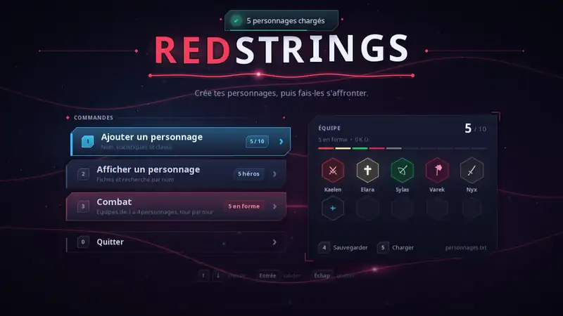
<sub>🎥 <b>Capture réelle</b> de l'écran de création : nom, glissières, onglets de catégorie, grille de classes, aperçu en direct, puis validation.</sub>
</div>

<details>
<summary><b>⚔️ Corps à corps · 8 classes</b></summary>

| Id | Classe | Couleur | PV | ATQ | DEF | SOIN | Description |
|:---:|---|:---:|:---:|:---:|:---:|:---:|---|
| 0 | **Guerrier** |  `#ef4444` | ±0 | **+5** | **+5** | −10 | Combattant polyvalent |
| 3 | **Paladin** |  `#eee527` | ±0 | −10 | **+5** | **+5** | Rempart sacré en armure lourde |
| 4 | **Berserker** |  `#cb285b` | **+5** | **+15** | −5 | −15 | Rage aveugle, frappe sans garde |
| 5 | **Chevalier noir** |  `#8657f1` | −5 | **+5** | **+10** | −10 | Lame maudite, armure d'ombre |
| 6 | **Samouraï** |  `#fb6e0f` | −5 | **+10** | ±0 | −5 | Maître du sabre, coup décisif |
| 7 | **Duelliste** |  `#e47f85` | −10 | **+10** | **+5** | −5 | Escrime vive et précise |
| 8 | **Lancier** |  `#edf3fc` | ±0 | **+10** | −5 | −5 | Allonge et charge brutale |
| 9 | **Gladiateur** |  `#a1774b` | **+10** | **+5** | −5 | −10 | Champion de l'arène |

</details>

<details>
<summary><b>✨ Magie · 8 classes</b></summary>

| Id | Classe | Couleur | PV | ATQ | DEF | SOIN | Description |
|:---:|---|:---:|:---:|:---:|:---:|:---:|---|
| 1 | **Mage** |  `#d946ef` | −10 | **+15** | ±0 | −5 | Arcanes offensives |
| 10 | **Archimage** |  `#2964d8` | −15 | **+20** | −5 | ±0 | Maîtrise absolue des arcanes |
| 11 | **Élémentaliste** |  `#16d8f4` | −5 | **+15** | −5 | −5 | Feu, glace et foudre |
| 12 | **Nécromancien** |  `#9afb5f` | **+5** | **+5** | −10 | ±0 | Draine la vie des vivants |
| 13 | **Invocateur** |  `#9996eb` | **+5** | ±0 | −5 | ±0 | Appelle des esprits alliés |
| 14 | **Druide** |  `#44862a` | ±0 | −5 | −5 | **+10** | Force de la nature |
| 15 | **Illusionniste** |  `#fab3ec` | −5 | ±0 | **+5** | ±0 | Trompe l'œil et l'esprit |
| 16 | **Chronomancien** |  `#97b7de` | −10 | **+5** | **+5** | ±0 | Plie le cours du temps |

</details>

<details>
<summary><b>🏹 Distance · 6 classes</b></summary>

| Id | Classe | Couleur | PV | ATQ | DEF | SOIN | Description |
|:---:|---|:---:|:---:|:---:|:---:|:---:|---|
| 2 | **Archer** |  `#22c55e` | −5 | **+10** | −5 | ±0 | Tir rapide à distance |
| 17 | **Chasseur** |  `#91922d` | ±0 | **+10** | −5 | −5 | Pisteur des terres sauvages |
| 18 | **Tireur d'élite** |  `#dde37c` | −15 | **+20** | −5 | ±0 | Un tir, une cible |
| 19 | **Assassin** |  `#787279` | −20 | **+20** | **+5** | −5 | Frappe dans l'ombre |
| 20 | **Ombrelame** |  `#a616fe` | −5 | **+5** | **+5** | −5 | Lame tissée d'ombre |
| 21 | **Corsaire** |  `#07aafa` | **+10** | **+5** | −10 | −5 | Pirate des mers lointaines |

</details>

<details>
<summary><b>🛡️ Soutien · 6 classes</b></summary>

| Id | Classe | Couleur | PV | ATQ | DEF | SOIN | Description |
|:---:|---|:---:|:---:|:---:|:---:|:---:|---|
| 22 | **Prêtre** |  `#efdcae` | **+5** | −15 | −5 | **+15** | Foi inébranlable |
| 23 | **Barde** |  `#c5529c` | ±0 | −5 | ±0 | **+5** | Chants qui galvanisent |
| 24 | **Alchimiste** |  `#71f4d9` | **+5** | −5 | −10 | **+10** | Potions et mixtures |
| 25 | **Ingénieur** |  `#f4b269` | −5 | −5 | **+10** | ±0 | Machines et tourelles |
| 26 | **Gardien** |  `#32719e` | **+5** | −20 | **+15** | ±0 | Mur vivant, défense ultime |
| 27 | **Moine** |  `#f0b11d` | **+5** | **+5** | −15 | **+5** | Corps et esprit en harmonie |

</details>


<a id="combat"></a>

## 04 · Le combat

### Composer les équipes

Tu choisis d'abord **ton équipe**, puis **celle de l'ordinateur**, de 1 à 4 personnages chacune (`TAILLE_EQUIPE_MAX`). Un personnage K.O. ou déjà engagé ne peut pas être choisi.

<div align="center">

<sub>🎥 <b>Capture réelle</b> : 3 alliés en cyan, 2 adversaires en rouge, prêts pour l'arène.</sub>
</div>

### Trois actions

<div align="center">
<sub>✏️ <b>Illustration.</b> Les trois exemples sont ceux de <code>tests/tests.c</code> : 40 × 50 % = 20, soin 40 → 75, garde 40 → 20.</sub>
</div>

| Action | Cible | Effet |
|---|---|---|
| ⚔️ **Attaquer** | un ennemi vivant | dégâts calculés ci-dessous ; à 0 PV, la cible est vaincue |
| ✚ **Soigner** | un allié vivant blessé, soi compris | rend `soin` PV sans dépasser les PV max ; impossible si personne n'est blessé ou si le soin vaut 0 |
| 🛡️ **Défendre** | soi-même | garde : −50 % sur les dégâts reçus jusqu'au **début de son prochain tour** |

### Les dégâts

La défense est un **pourcentage de réduction**. Le calcul se fait en entiers (la division tronque), la garde divise encore par deux, et une attaque inflige **au moins 1** dégât :

$$
\text{dégâts} = \max\left(1,\ \left\lfloor \frac{\text{attaque} \times (100 - \text{défense})}{100} \right\rfloor \times g\right)
\qquad g = \begin{cases} 0{,}5 & \text{en garde} \\ 1 & \text{sinon} \end{cases}
\qquad
\text{PV}_{\text{cible}} = \max(0,\ \text{PV}_{\text{cible}} - \text{dégâts})
$$

<div align="center">
<sub>✏️ <b>Illustration</b> de la formule : 85 × (100 − 30) / 100 = 59,5, tronqué à 59.</sub>
</div>

| Attaque | Défense | Calcul | Dégâts |
|:---:|:---:|---|:---:|
| 85 | 30 | 85 × 70 / 100 = 59,5 → **59** | 🟥 59 |
| 40 | 50 | 40 × 50 / 100 | 🟧 20 |
| 40 | 0, en garde | 40 × 50 % | 🟨 20 |
| 60 | 99 | 60 × 1 / 100 = 0,6 → 0 → **minimum 1** | ⬜ 1 |

### L'ordre des tours

<div align="center">
<sub>✏️ <b>Illustration</b> de l'ordre déterministe : J1, A1, J2, A2, J3… Un personnage vaincu est sauté.</sub>
</div>

Le combat s'arrête dès qu'une équipe n'a plus personne debout. Il travaille sur des **copies** des personnages : les PV perdus et les gardes disparaissent à la fin, le roster n'est jamais modifié.

**L'ordinateur** ([`bataille_ia`](src/personnage/bataille.c)) suit trois règles simples et prévisibles : soigner l'allié le plus blessé s'il est sous la moitié de ses PV, se mettre en garde sous le quart de ses PV, sinon attaquer l'ennemi qui a le moins de PV.

### Le même combat, dans le terminal

<div align="center">
<sub>✏️ <b>Illustration</b> rejouant une vraie session, condensée : les messages, les PV (Varek 75 → 34 → 0, Elara 55 → 3 → K.O.) et la mise en page des lignes sont ceux du programme. La compilation montrée est raccourcie (un vrai <code>make</code> compile aussi les 40 fichiers de <code>lib/</code>).</sub>
</div>

<details>
<summary><b>📜 Le texte brut de cette session</b></summary>

<br/>

```text
  Choix (0-5) › 3
  Ton équipe (1 à 4, ligne vide pour terminer)
  1. › Kaelen
  2. › Elara
  3. ›
  Équipe adverse (jouée par l'ordinateur) (1 à 4, ligne vide pour terminer)
  1. › Varek

  ── Équipe adverse ──
   1 Varek          Berserker       ■■■■■■■■■■■■  75/75
  ── Ton équipe ──
  ▶1 Kaelen         Guerrier        ■■■■■■■■■■■■  60/60
   2 Elara          Prêtre          ■■■■■■■■■■■■  55/55

  Tour de Kaelen
    1  Attaquer
    2  Soigner
    3  Défendre
  Action (1-3) › 3
  » Kaelen adopte une posture défensive.
  » Varek attaque Elara et inflige 52 dégâts.
  …
  Action (1-3) › 1
    1  Varek          -40 PV
    0  Retour
  Cible (0-1) › 1
  » Kaelen attaque Varek et inflige 40 dégâts.
  » Varek est vaincu.
  » L'équipe adverse a été vaincue.

  ✔ Victoire !
```
<sub>Extrait d'une vraie session (couleurs retirées).</sub>

</details>


<a id="mecaniques"></a>

## 05 · Les mécaniques

### Le menu de la console

```
╭────────────────────────────────────╮
│  ✦ Menu principal                  │
├────────────────────────────────────┤
│  1  Ajouter un personnage          │
│  2  Afficher un personnage         │
│  3  Combat                         │
│  4  Sauvegarder                    │
│  5  Charger                        │
│  0  Quitter                        │
╰────────────────────────────────────╯
  Choix (0-5) ›
```

| Touche | Action | Ce qui se passe |
|:---:|---|---|
| <kbd>1</kbd> | **Ajouter** | Nom → PV → Attaque → Défense → Soin → Classe. Le nom doit être unique. |
| <kbd>2</kbd> | **Afficher** | Fiche avec barres de statistiques et couleur de la classe. |
| <kbd>3</kbd> | **Combat** | Ton équipe, puis celle de l'ordinateur, puis le combat au tour par tour. |
| <kbd>4</kbd> | **Sauvegarder** | Écrit tous les personnages dans `personnages.txt`. |
| <kbd>5</kbd> | **Charger** | Remplace l'équipe par le contenu de `personnages.txt`. |
| <kbd>0</kbd> ou <kbd>Ctrl</kbd>+<kbd>D</kbd> | **Quitter** | Libère la mémoire, puis « À bientôt ! ». |

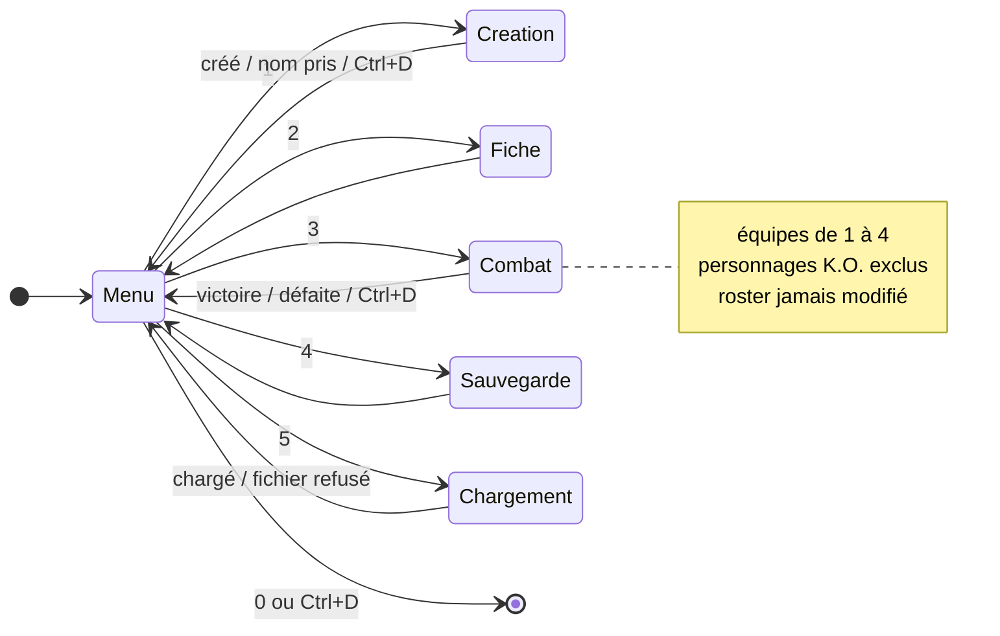

<details>
<summary><b>📋 Ce que le jeu accepte (et refuse)</b></summary>

<br/>

| Saisie | Règle | Si c'est faux |
|---|---|---|
| Nom | 1 mot, 29 caractères max, **unique** | `✗ Ce nom est déjà pris` |
| PV / Attaque / Défense / Soin | entier de **0 à 99** (statistiques de base, avant la classe) | `✗ Valeur invalide`, puis la question est reposée |
| Classe | de 1 à 28, listées par catégorie | `✗ Valeur invalide` |
| `12abc`, `abc`, `99999999999` | refusés : `strtol` contrôle **toute** la ligne | `✗ Valeur invalide` |
| <kbd>Ctrl</kbd>+<kbd>D</kbd> pendant une création | la création est annulée | `✗ Saisie interrompue` |

</details>

### Les commandes de la fenêtre

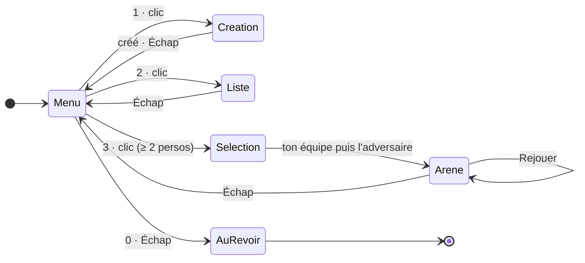

| Écran | Clavier | Souris |
|---|---|---|
| **Menu** | <kbd>↑</kbd> <kbd>↓</kbd> choisir · <kbd>Entrée</kbd> valider · <kbd>1</kbd> <kbd>2</kbd> <kbd>3</kbd> raccourcis · <kbd>4</kbd> sauvegarder · <kbd>5</kbd> charger · <kbd>0</kbd>/<kbd>Échap</kbd> quitter | survol pour choisir, clic pour valider |
| **Création** | <kbd>Tab</kbd> / <kbd>↑</kbd> <kbd>↓</kbd> naviguer · <kbd>←</kbd> <kbd>→</kbd> ajuster, ou changer de classe · <kbd>Maj</kbd> = ×10, ou catégorie suivante · <kbd>Entrée</kbd> créer | glissières, onglets de catégorie, grille de classes, bouton |
| **Personnages** | taper pour rechercher · <kbd>Entrée</kbd> ouvrir · <kbd>←</kbd> <kbd>→</kbd> changer de fiche | clic sur une carte |
| **Composition** | <kbd>←</kbd> <kbd>→</kbd> <kbd>↑</kbd> <kbd>↓</kbd> choisir une carte · <kbd>Espace</kbd> ajouter / retirer · <kbd>Entrée</kbd> valider l'équipe · <kbd>Échap</kbd> étape précédente | clic sur une carte, bouton *Valider* / *Lancer le combat* |
| **Arène** | <kbd>1</kbd> <kbd>2</kbd> <kbd>3</kbd> ou <kbd>←</kbd> <kbd>→</kbd> + <kbd>Entrée</kbd> action · <kbd>←</kbd> <kbd>→</kbd> cible · <kbd>Entrée</kbd> confirmer · <kbd>Échap</kbd> retour · fin : <kbd>Entrée</kbd>/<kbd>R</kbd> rejouer, <kbd>Échap</kbd> menu | boutons d'action, survol / clic sur une cible |
| **Partout** | <kbd>F11</kbd> ou <kbd>Alt</kbd>+<kbd>Entrée</kbd> : fenêtré ↔ plein écran · <kbd>Maj</kbd>+<kbd>F11</kbd> : plein écran natif ou sans bordure | bords de la fenêtre pour la redimensionner |

> [!NOTE]
> **Fenêtre libre.** La fenêtre se redimensionne à la souris (800 × 600 au minimum), et passe en plein écran sans bordure (par défaut) ou natif sans redémarrer : la partie en cours, les animations et la saisie sont conservées. L'interface garde au moins 1024 × 720 unités visibles et grossit au plus ×2 : en dessous, la création se réorganise et les grilles de cartes choisissent leurs colonnes ; au-delà, l'espace en plus sert à respirer. Le combat garde sa composition (mise à l'échelle uniforme) et ses panneaux s'ancrent aux coins réels de la fenêtre. Le texte est tramé à sa taille réelle, donc net à toute taille.

> [!WARNING]
> L'écran n'a de place que pour **10 cartes** (`MAX_PERSONNAGES`) : la fenêtre refuse de créer un 11ᵉ personnage, et refuse de charger un fichier qui en contient plus (l'équipe actuelle n'est alors pas touchée). La console, elle, n'a pas de limite.

### La sauvegarde

Un personnage par ligne, au format texte : `nom pv attaque défense classe soin`, où la classe est l'identifiant de 0 à 27 des tableaux ci-dessus.

```text
Aragorn 80 60 30 0 10
Elara 55 15 10 22 40
```

> [!NOTE]
> **Compatibilité.** Le soin est ajouté *en fin de ligne* pour ne pas déplacer la classe. Une ligne à 5 champs, écrite avant cette statistique, reste lisible : le personnage reçoit `SOIN_MIGRATION` (20), modifié par sa classe. Elle est réécrite au format complet à la prochaine sauvegarde.

Le chargement est **transactionnel** : tout le fichier est lu dans un roster temporaire, qui remplace l'équipe seulement s'il est entièrement valide.

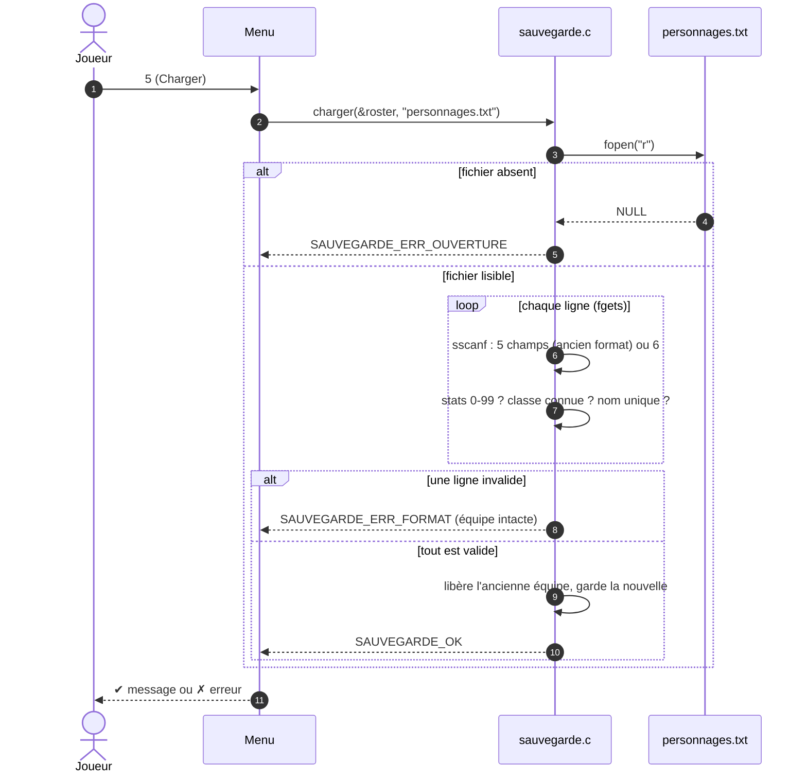

| Code de retour | Message affiché |
|---|---|
| `SAUVEGARDE_OK` | `✔ N personnage(s) chargé(s)` / `sauvegardé(s)` |
| `SAUVEGARDE_ERR_OUVERTURE` | `✗ Impossible d'ouvrir le fichier` |
| `SAUVEGARDE_ERR_ECRITURE` | `✗ Erreur pendant l'écriture` (`fprintf` ou `fclose` a échoué) |
| `SAUVEGARDE_ERR_FORMAT` | `✗ Fichier corrompu : chargement annulé` |
| `SAUVEGARDE_ERR_MEMOIRE` | `✗ Mémoire insuffisante` |


<a id="choix-techniques"></a>

## 06 · Les choix techniques

**1. Un moteur qui n'affiche rien.** [`bataille.c`](src/personnage/bataille.c) ne contient ni `printf` ni CSFML. Les interfaces lui envoient une **action** (`bataille_agir(b, ACTION_ATTAQUER, cible, ev)`) et reçoivent en retour une liste d'**événements** déjà résolus. La console les écrit, la fenêtre les anime.

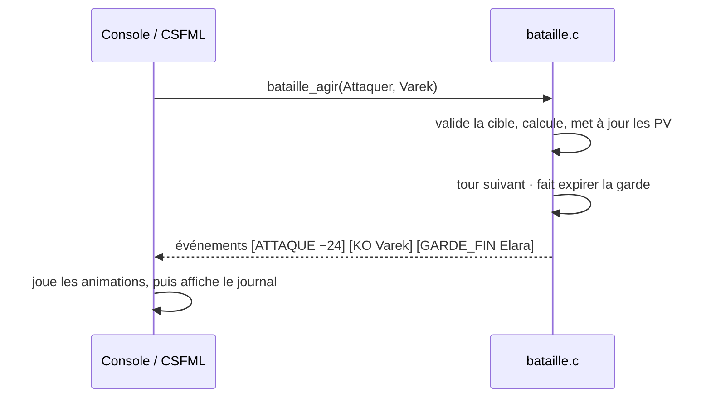

> [!IMPORTANT]
> Les animations **ne décident jamais** du résultat : le moteur renvoie des événements déjà résolus (dégâts, PV après, garde utilisée, K.O., victoire). L'arène les joue dans le temps et met à jour les PV affichés et le journal **au moment de l'impact**, sans rien recalculer.

**2. Une seule source de vérité pour les classes.** La table `classes[]` donne à la fois la couleur ANSI 24 bits du terminal, la couleur CSFML, l'emblème et les modificateurs. Les illustrations de ce README la lisent aussi.

**3. Des copies pour combattre.** `bataille_init` copie les personnages dans des `combattant_t` (PV actuels, PV max, effets). Un combat ne peut donc pas abîmer le roster ni la sauvegarde.

**4. Des effets prêts à grandir.** La garde est un `effet_t` avec une durée, rangé dans un tableau de `MAX_EFFETS`. D'autres effets (poison, étourdissement…) pourront s'y ajouter sans toucher aux interfaces.

**5. Une bibliothèque maison.** Le code n'appelle ni `strlen`, ni `strcmp`, ni `strcpy` : il passe par `my_strlen`, `my_strcmp`, `my_strcpy` de **`libmy.a`**, 40 fonctions réécrites à la main.

<details>
<summary><b>🔐 Robustesse : ce qui a été reproduit, puis corrigé</b></summary>

<br/>

Le projet a été audité point par point (voir [`AMELIORATIONS.md`](AMELIORATIONS.md)) :

| | Avant | Après |
|:---:|---|---|
| 🔴 | <kbd>Ctrl</kbd>+<kbd>D</kbd> au menu → **boucle infinie** | `lire_entier` renvoie `-1` sur fin d'entrée → sortie propre |
| 🔴 | `scanf` du nom jamais vérifié → nom **non initialisé** | retour vérifié, tampon initialisé |
| 🟠 | `scanf("%d")` acceptait `12abc` et pouvait déborder | `fgets` + `strtol` : toute la ligne doit être un nombre, dans les bornes |
| 🟠 | deux personnages pouvaient porter **le même nom** | `trouver_personnage` avant chaque création |
| 🟡 | `sprintf` sans limite dans les barres de stats | `snprintf` avec la taille du tampon |
| 🟠 | un personnage pouvait **s'attaquer lui-même** | le moteur refuse la cible |
| 🟡 | un personnage **K.O.** pouvait encore agir | il est sauté et ne peut pas être ciblé |
| 🔴 | modifier un `.h` ne recompilait rien | dépendances `-MMD -MP` |
| 🟢 | 10 personnages maximum | `roster_t` + `realloc` |

```diff
- int ret = scanf("%d", &choix);          // "12abc" → 12, Ctrl+D → boucle infinie
+ if (lire_entier("Choix", 0, 5, &choix) == -1)
+     choix = 0;                           // fin d'entrée : on quitte proprement
```

> [!TIP]
> `boite_ligne()` et `boite_champ()` sont déclarées avec `__attribute__((format(printf, …)))` : gcc vérifie leurs formats comme ceux de `printf`. Un `%d` avec une chaîne devient une **erreur de compilation**, pas un affichage faux en pleine partie.

</details>


<a id="architecture"></a>

## 07 · L'architecture

<div align="center">
<sub>✏️ <b>Illustration.</b> La fenêtre compile directement les fichiers du moteur (<code>MOTEUR</code> dans <code>csfml/Makefile</code>) : <code>personnage.c combat.c bataille.c roster.c sauvegarde.c</code>.</sub>
</div>

```text
RedStrings/
├── 📁 includes/              ← un header = un thème
│   ├── personnage.h          personnage_t, classe_t, catalogue classes[], statistiques
│   ├── bataille.h            combat en équipe : tours, actions, effets, événements
│   ├── bataille_console.h    menu_bataille()
│   ├── roster.h              tableau dynamique de personnages
│   ├── sauvegarde.h          sauvegarder / charger + codes d'erreur
│   ├── boite.h               boîtes Unicode, alignement des libellés
│   ├── saisie.h              lire_ligne, lire_entier, vider_buffer
│   ├── couleurs.h            codes ANSI (ROUGE, VERT, GRAS…)
│   ├── my.h · my_string.h    prototypes de libmy.a
│   └── redstrings.h          point d'entrée du menu
├── 📁 src/
│   ├── main.c                return redstrings();
│   ├── redstrings.c          boucle du menu
│   ├── 📁 personnage/        moteur : personnage · combat · bataille · roster · sauvegarde
│   │                         console : creer_personnage · afficher_personnage
│   └── 📁 ui/                boite.c · saisie.c · bataille_console.c
├── 📁 lib/                   40 fonctions maison → libmy.a
├── 📁 csfml/                 version graphique
│   ├── include/              14 headers gui_*.h, un par thème (config, types, anim, dessin, ui…)
│   ├── src/                  app/ · outils/ · rendu/ · ui/ · yugioh/ · scenes/{menu,creation,liste,selection,arene}/
│   ├── tests/                tests.c : UTF-8, animation, classes (sans fenêtre)
│   ├── assets/fonts/         polices
│   └── Makefile
├── 📁 tests/                 tests.c (assert)
├── 📁 .github/readme/        images de ce README et leur générateur
└── Makefile
```

### Qui dépend de qui

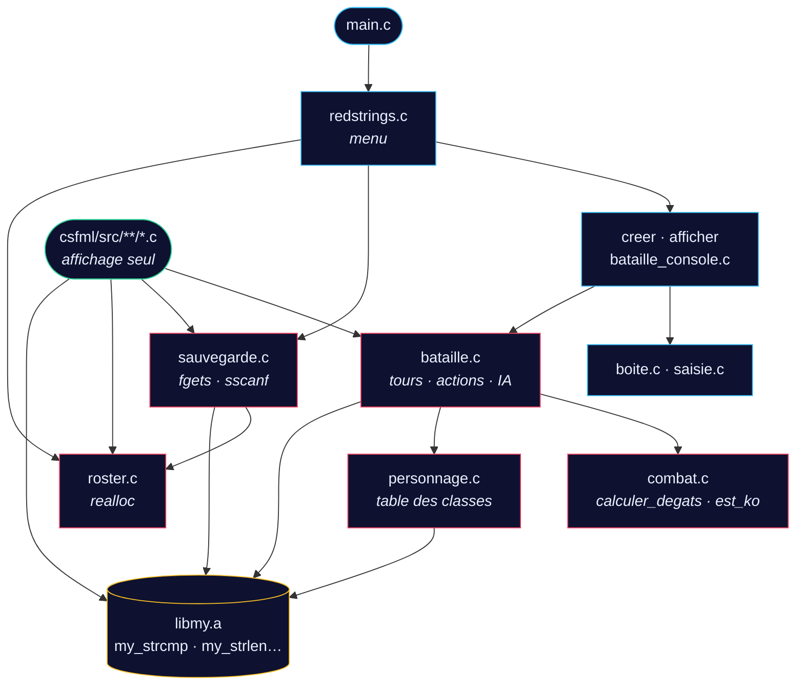

### Les structures de données

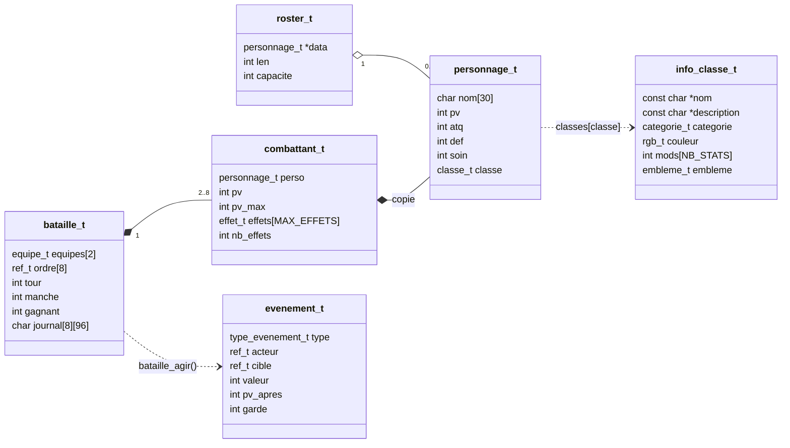

<details>
<summary><b>📈 Comment le roster grandit (realloc ×2)</b></summary>

<br/>

```text
ajout n°  1   capacité  4   [■□□□]
ajout n°  5   capacité  8   [■■■■■□□□]                    ← realloc
ajout n°  9   capacité 16   [■■■■■■■■■□□□□□□□]            ← realloc
ajout n° 17   capacité 32   …
```

```c
tmp = realloc(r->data, (size_t)nouvelle * sizeof(*tmp));
if (tmp == NULL)
    return -1;      // r->data reste valide : pas de fuite
r->data = tmp;
```

> [!WARNING]
> Ne jamais écrire `r->data = realloc(r->data, …)` : si `realloc` échoue, il renvoie `NULL` et l'ancien tableau est perdu. C'est une fuite mémoire.

</details>

<details>
<summary><b>📊 Répartition du code</b></summary>

<br/>

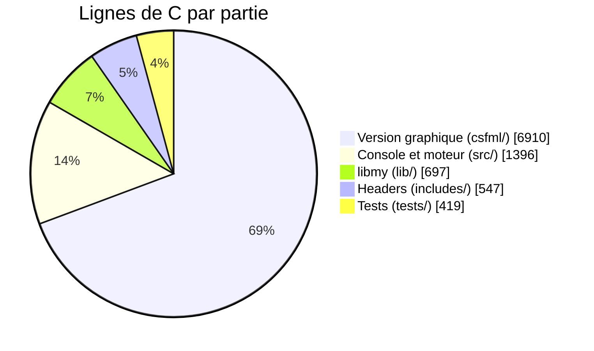

<sub>Compté avec <code>wc -l</code> sur les fichiers <code>.c</code> et <code>.h</code> de chaque dossier.</sub>

</details>

<details>
<summary><b>📚 Les 40 fonctions de libmy.a</b></summary>

<br/>

| Header | Famille | Fonctions |
|---|---|---|
| `my_string.h` | Longueur, comparaison | `my_strlen` · `my_strcmp` · `my_strncmp` · `my_strstr` |
| `my_string.h` | Copie, concaténation | `my_strcpy` · `my_strncpy` · `my_strcat` · `my_strncat` · `my_strdup` |
| `my_string.h` | Transformation | `my_revstr` · `my_strupcase` · `my_strlowcase` · `my_strcapitalize` |
| `my_string.h` | Tests (1 = vrai) | `my_str_isalpha` · `my_str_islower` · `my_str_isupper` · `my_str_isnum` · `my_str_isprintable` |
| `my.h` | Affichage | `my_putchar` · `my_putstr` · `my_put_nbr` · `my_showstr` · `my_showmem` |
| `my.h` | Nombres | `isneg` · `my_getnbr` · `my_compute_power_rec` · `my_compute_square_root` · `my_is_prime` · `my_find_prime_sup` · `my_swap` · `my_sort_int_array` |
| `my.h` | Tableaux et paramètres | `my_arraylen` · `my_arraystrlen` · `my_str_to_word_array` · `my_show_word_array` · `my_swap_params` · `my_print_params` · `my_rev_params` · `my_sort_params` · `concat_params` |

</details>


<a id="installer"></a>

## 08 · Installer et compiler

```bash
git clone https://github.com/Vylllixis/RedStrings.git
cd RedStrings
make            # compile ./redstrings (et lib/libmy.a au passage)
./redstrings    # version terminal
```

### La version graphique

Elle a besoin de **CSFML** (le binding C de SFML) :

| Système | Commande |
|---|---|
| 🐧 Debian / Ubuntu | `sudo apt install libcsfml-dev` |
| 🎩 Fedora | `sudo dnf install CSFML-devel` |
| 🏔️ Arch | `sudo pacman -S csfml` |

```bash
make csfml            # compile ./redstrings_csfml
./redstrings_csfml
```

> [!TIP]
> Si CSFML manque, `make csfml` s'arrête tout de suite avec un message clair au lieu d'une erreur de compilation :
> `✗ CSFML introuvable, installe-la avec : sudo apt install libcsfml-dev`

> [!NOTE]
> Les polices (Noto Sans, DejaVu Sans) sont cherchées à côté de l'exécutable, puis depuis le dossier courant : tu peux lancer le jeu depuis n'importe où dans le projet.

<details>
<summary><b>🃏 Un mode caché…</b></summary>

<br/>

```bash
./redstrings_csfml "Yu-Gi-Oh!"     # les guillemets comptent : l'argument contient un point d'exclamation
```

Le même jeu, habillé en duel de cartes. **Seul le rendu change** : mêmes 28 classes, mêmes noms, mêmes statistiques, même moteur de combat, même sauvegarde. Sans argument, rien ne change ; un autre argument est refusé (`usage`, code 84).

- **Création** : la grille des classes devient une main de cartes distribuée face cachée, qui se retourne, se soulève au survol et s'incline vers la souris. L'aperçu montre une grande carte qui fait un tour complet à chaque changement de classe, avec un reflet holographique.
- **Fiche** : la carte du personnage, en perspective, à côté de ses vraies statistiques.
- **Arène** : chaque carte s'ouvre au-dessus de son combattant puis plonge dans son jeton ; la carte de l'acteur s'active pendant une attaque, un soin ou une garde ; tes cartes brillent à la victoire et se grisent à la défaite.
- **Partout** : l'illustration remplace l'emblème dans les hexagones (menu, cartes, jetons, ordre des tours).

Le titre de chaque carte est le **nom de la classe RedStrings** : le nom officiel de la carte ne sert qu'à retrouver son illustration (`csfml/src/yugioh/cartes.c`). Les illustrations ne sont pas dans le dépôt : elles appartiennent à leurs ayants droit (Kazuki Takahashi / Konami). Le script les télécharge en local depuis la base YGOPRODeck :

```bash
sh csfml/assets/yugioh/telecharger.sh
```

Sans elles, le mode fonctionne quand même : chaque carte montre l'emblème de sa classe.

| Classe | Carte | Cadre |
|---|---|---|
| Guerrier | Gilford the Legend | Effet |
| Mage | Dark Magician | Normal |
| Archer | Arcane Archer of the Forest | Effet |
| Paladin | Paladin of White Dragon | Rituel |
| Berserker | Beast King Barbaros | Effet |
| Chevalier noir | Dark Blade | Normal |
| Samouraï | Legendary Six Samurai - Shi En | Synchro |
| Duelliste | Flame Swordsman | Fusion |
| Lancier | Gaia The Fierce Knight | Normal |
| Gladiateur | Gladiator Beast Laquari | Effet |
| Archimage | Endymion, the Master Magician | Effet |
| Élémentaliste | Elemental Mistress Doriado | Rituel |
| Nécromancien | Zombie Master | Effet |
| Invocateur | Aleister the Invoker | Effet |
| Druide | Aurkus, Lightsworn Druid | Effet |
| Illusionniste | Illusionist Faceless Mage | Normal |
| Chronomancien | Time Wizard | Effet |
| Chasseur | Amazoness Archer | Effet |
| Tireur d'élite | Machina Sniper | Effet |
| Assassin | Night Assailant | Effet |
| Ombrelame | The Phantom Knights of Break Sword | Xyz |
| Corsaire | Blackeyes, the Plunder Patroll Seaguide | Effet |
| Prêtre | St. Joan | Fusion |
| Barde | Aria the Melodious Diva | Effet |
| Alchimiste | Alchemist of Black Spells | Effet |
| Ingénieur | Ancient Gear Engineer | Effet |
| Gardien | Big Shield Gardna | Effet |
| Moine | Master Monk | Effet |

</details>

<details>
<summary><b>🧰 Prérequis</b></summary>

<br/>

| Outil | Pourquoi | Vérifier |
|---|---|---|
| `gcc` (C11) | compilation | `gcc --version` |
| `make` | construction | `make --version` |
| `ar` | archive `libmy.a` | `ar --version` |
| CSFML *(optionnel)* | version graphique | `ls /usr/include/SFML/Graphics.h` |

</details>

### Le Makefile

| Commande | Résultat |
|---|---|
| `make` | compile `./redstrings` (et `lib/libmy.a` si besoin) |
| `make lib` | compile seulement `lib/libmy.a` |
| `make debug` | `./redstrings_debug` avec `-g3 -O0 -fsanitize=address,undefined` |
| `make tests` | compile et lance les tests unitaires (avec les sanitizers) |
| `make csfml` | compile `./redstrings_csfml` |
| `make csfml-debug` | `./redstrings_csfml_debug` avec les sanitizers |
| `make csfml-tests` | tests de la version graphique, sans fenêtre (UTF-8, animation, classes) |
| `make clean` | supprime les `.o` |
| `make fclean` | supprime aussi les exécutables et `libmy.a` |
| `make re` | `fclean` puis `make` |
| `make build` | comme `re`, mais ne garde que les exécutables |
| `make V=1` | affiche les commandes complètes au lieu des lignes courtes |
| `make help` | liste toutes ces règles |

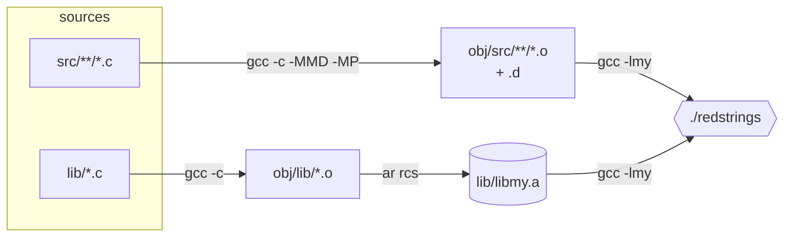

<details>
<summary><b>🚩 Les flags, un par un</b></summary>

<br/>

```makefile
CFLAGS = -std=c11 -Wall -Wextra -Werror -pedantic -Wshadow -Wmissing-prototypes
```

| Flag | Ce qu'il apporte |
|---|---|
| `-std=c11` | fixe la version du C : le code compile pareil partout |
| `-Wall -Wextra` | la grande majorité des avertissements utiles |
| `-Werror` | un avertissement **bloque** la compilation |
| `-pedantic` | refuse les extensions non standard de gcc |
| `-Wshadow` | signale une variable qui en cache une autre |
| `-Wmissing-prototypes` | toute fonction publique doit être déclarée dans un `.h` |
| `-MMD -MP` | modifier un `.h` recompile tous les `.c` qui l'incluent |

</details>

<a id="tests"></a>

### Les tests

```bash
make tests
```

`tests/tests.c` est compilé avec **tout le jeu sauf `main.c`**, plus AddressSanitizer et UBSan : un débordement, un comportement indéfini **ou une fuite mémoire** fait échouer les tests. Aucune fenêtre n'est ouverte : le moteur de combat se teste seul.

| Domaine | Ce qui est vérifié |
|---|---|
| `my_strcmp` | égalité, différence, préfixe, chaînes vides |
| `calculer_degats` | 40 × 50 % = 20 · défense 100 → 0 dégât · K.O. à 0 PV |
| Catalogue | ≥ 20 classes, noms uniques, descriptions courtes, catégories et emblèmes valides, modificateurs bornés de somme nulle, couleurs distinctes deux à deux |
| Modificateurs | Berserker 50/50/50/20 → 55/65/45/5, Prêtre soin 20 → 35, bornes 0 et 99 |
| Bataille | équipes invalides refusées, ordre alterné, dégâts et minimum de 1, K.O. jamais négatif, vaincu ni jouable ni ciblable, soin 40 → 75 et plafonné, garde −50 % puis expiration, IA, combat entier 4 contre 3, roster intact |
| Compatibilité | une ligne sans soin se relit (migration), le soin fait l'aller-retour, champ en trop ou soin hors limites refusés, identifiant hors catalogue refusé |
| `trouver_personnage` | trouvé, absent, sensible à la casse, tableau vide |
| `roster_t` | 100 ajouts d'affilée, ordre conservé, libération complète |
| Sauvegarde | aller-retour fichier → mémoire identique |
| Chargement refusé | fichier absent · classe inconnue · stat > 99 · nom en double · ligne tronquée · texte au lieu d'un nombre (et l'équipe reste intacte) |
| Version graphique (`make csfml-tests`) | UTF-8 : aller-retour, séquences tronquées / trop longues / substituts refusés, bornes du tampon · courbes d'animation · couleurs jamais hors d'un octet · recherche par nom · identifiant de classe hors table |


<a id="contribuer"></a>

## 09 · Contribuer

### Le flux de travail

Le dépôt suit **git flow** : chaque changement vit sur sa propre branche partie de `develop`, puis y est fusionné avec `--no-ff`. `main` ne reçoit que les versions publiées (`v0.1.0` → `v1.3.0`).

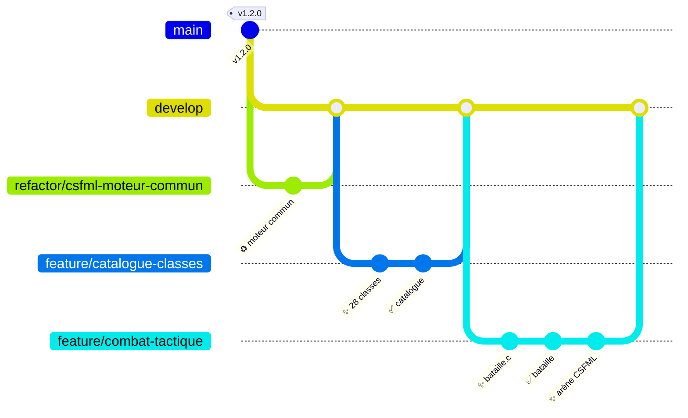

<table>
<tr><td valign="top" width="50%">

#### Commits (gitmoji, en français)

| | Type | Usage |
|:---:|---|---|
| ✨ | `feat` | nouvelle fonctionnalité |
| 🐛 | `fix` | correction de bug |
| ♻️ | `refactor` | restructuration sans changer le comportement |
| ✅ | `test` | tests |
| 🔨 | `build` | Makefile |
| 📝 | `docs` | documentation |
| 🔀 | `merge` | fusion d'une branche |
| 🔖 | `chore(release)` | nouvelle version |

Exemple : `✨ feat(bataille): moteur de combat en équipe, au tour par tour`

</td><td valign="top" width="50%">

#### Nommage du code

| Élément | Style | Exemple |
|---|---|---|
| Fonctions | `snake_case` | `creer_personnage` |
| Variables, champs | `snake_case` | `nb_persos`, `p->atq` |
| Types | `snake_case_t` | `roster_t` |
| Macros, `enum` | `MAJUSCULES` | `STAT_MAX`, `MAGE` |
| Fichiers | `snake_case.c` | `afficher_personnage.c` |
| Langue | français | `trouver_personnage` |

</td></tr>
</table>

### Avant de proposer un changement

```bash
make re && make tests      # aucun avertissement (-Werror), aucun test ni sanitizer en échec
make csfml                 # si CSFML est installée
```

> [!TIP]
> **Ajouter une classe** : une valeur juste avant `NB_CLASSES` dans l'`enum` (jamais au milieu : l'identifiant est écrit dans les sauvegardes), puis une ligne dans `classes[]`. Les listes de la console, les onglets et la grille de la fenêtre, l'aperçu et les tests la prennent en compte sans autre modification.

### Régénérer les illustrations du README

Les SVG de `.github/readme/` sont produits par un script Python 3 sans dépendance, qui relit le catalogue des classes. Après une modification de `classes[]` :

```bash
python3 .github/readme/outils/generer_svg.py
```

Le résultat est déterministe : deux exécutions donnent les mêmes fichiers. Chaque animation a pour état de base son image **finale**, donc un afficheur qui ignore les animations montre quand même l'image complète. Les captures (`.github/readme/captures/*.webp`) sont des enregistrements du jeu et ne sont pas générées.


<a id="licence"></a>

## 10 · Licence

Le dépôt ne contient **pas encore de fichier `LICENSE`**. Tant qu'aucune licence n'est choisie, le code reste sous le droit d'auteur par défaut de son auteur : le lire est possible, mais aucune autorisation de réutilisation n'est accordée. Les polices de `csfml/assets/fonts/` gardent leurs propres licences.


## ❓ FAQ

<details>
<summary><b>« make: Rien à faire pour all » alors que j'ai modifié un header ?</b></summary>
<br/>
Ça ne devrait plus arriver : gcc génère un fichier <code>.d</code> par objet (<code>-MMD -MP</code>) et le Makefile le charge. Si tu as gardé un vieux dossier <code>obj/</code>, fais un <code>make re</code> une fois.
</details>

<details>
<summary><b>Où est mon fichier de sauvegarde ?</b></summary>
<br/>
Dans le dossier depuis lequel tu as lancé le jeu : <code>personnages.txt</code>. Il est ignoré par git, et les deux versions du jeu lisent le même.
</details>

<details>
<summary><b>Le chargement dit « Fichier corrompu » : j'ai perdu mon équipe ?</b></summary>
<br/>
Non. Le fichier est lu dans un roster temporaire : en cas d'erreur, ton équipe actuelle n'est pas touchée.
</details>

<details>
<summary><b>Mes personnages perdent-ils leurs PV après un combat ?</b></summary>
<br/>
Non. Le combat travaille sur des copies : à la fin, chacun retrouve ses statistiques d'origine.
</details>

<details>
<summary><b>Comment traquer un bug mémoire ?</b></summary>
<br/>

```bash
make debug
./redstrings_debug        # s'arrête avec la ligne exacte du problème
gdb ./redstrings_debug    # ou pas à pas
```

</details>

<details>
<summary><b>Pourquoi des noms sans espace ?</b></summary>
<br/>
Le nom sert d'identifiant (recherche, équipes, fichier de sauvegarde). Il est lu avec <code>scanf("%29s")</code>, qui s'arrête au premier espace : 29 caractères maximum, plus le <code>'\0'</code>, pour tenir dans <code>char nom[30]</code>.
</details>

<br/>

<div align="center">


<sub>Projet fil rouge · <b>Langage C avancé</b> · ESGI 2ᵉ année · 2026</sub><br/>
<sub>Fait avec <code>gcc -Werror</code> et beaucoup de <code>printf</code> par <a href="https://github.com/Vylllixis"><b>Vyllixis</b></a></sub>

</div>
