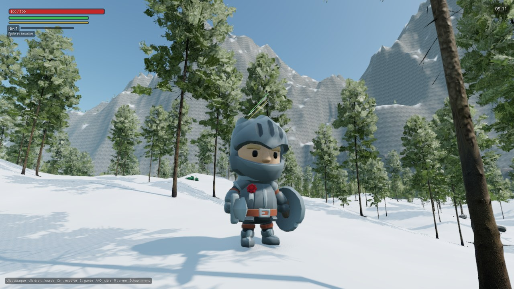
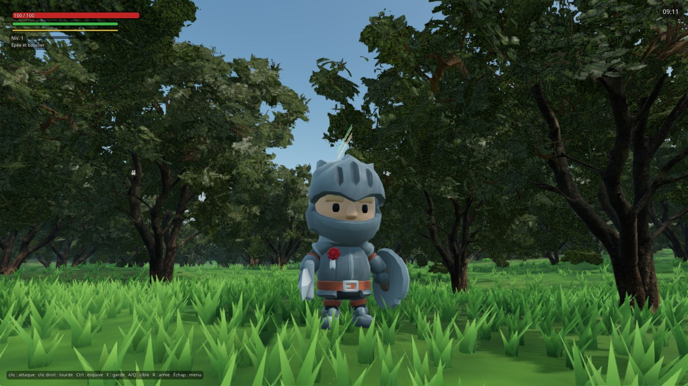

# Arbres réalistes (2026-11-22)

Demande de Théo : « un rendu ultra réaliste, seulement des arbres ». Les arbres du monde ouvert
sont désormais de **vrais arbres scannés** (Poly Haven, domaine public), convertis en arbres de
jeu par un outil du dépôt, `treebake`, et dessinés par des shaders faits pour le feuillage.

| Essence du jeu | Arbre scanné | Dans la source | De près | Mi-distance | De loin |
|---|---|---|---|---|---|
| chêne de la plaine (9 m) | jacaranda | 3 863 832 triangles | 9 198 | 2 298 | 8 |
| sapin de la montagne (11 m, enneigé) | sapin (`fir_tree_01`, le premier des trois) | 4 176 819 | 9 194 | 2 296 | 8 |
| arbre du désert (6,5 m) | arbre à carquois (`quiver_tree_01`) | 150 124 | 13 998 | 2 997 | 8 |

Les arbres simples d'avant (28 à 600 triangles, `tools/scripts/arbres_make.py`) existent toujours :
`--trees simple`, ou la variable d'environnement `OW_TREES=simple` (c'est ce qu'utilisent les
tests automatiques, voir plus bas). Buissons et rochers ne changent pas.





Captures du jeu (`--trees real`) en rendu logiciel, 1280 x 720, le 2026-11-23, juste avant le
dernier réglage : le feuillage livré est un peu plus clair.

Ce document ne parle pas d'Unreal Engine : il n'est pas installé sur la machine et son
installation demande un compte Epic et l'acceptation d'une licence, ce que l'outil d'aide au code
ne peut pas faire à la place de Théo. Ce qu'Unreal apporte pour un arbre (une géométrie de film
et un moteur de rendu qui sait la dessiner) est remplacé ici par : des arbres scannés libres, et
la technique classique des jeux pour les dessiner par centaines.

## 1. Pourquoi une conversion

Un arbre scanné est une géométrie de film : chaque feuille, chaque aiguille est faite de
triangles. Le sapin en compte 4 millions ; une forêt de 2 000 sapins, 8 milliards. Aucun jeu ne
dessine cela. La technique habituelle, reprise ici :

1. le **tronc** et les grosses branches restent un maillage, **allégé** (on retire les sommets
   dont la disparition déforme le moins la surface) ;
2. le **feuillage** (feuilles et rameaux) est remplacé par des **cartes** : des rectangles qui
   portent la *photographie* d'un bouquet de feuilles, découpée par sa transparence ;
3. de loin, l'arbre entier n'est plus que quatre rectangles croisés portant sa photographie.

## 2. L'outil `treebake`

```
treebake <source.gltf> <dossier> <nom> [options]
```

| Option | Rôle | Défaut |
|---|---|---|
| `--node F` | ne lire que les nœuds dont le nom contient F (un fichier peut contenir plusieurs arbres) | tous |
| `--trunk a,b` | matières gardées en maillage (fragments de noms) ; les autres sont du feuillage | aucune |
| `--drop a,b` | matières ignorées | aucune |
| `--height M` | hauteur finale en mètres | celle de la source |
| `--sink P` | part de la hauteur enfoncée dans le sol (le pied ne flotte pas sur une pente) | 0,02 |
| `--clusters N` | grappes de feuillage : autant d'emplacements de cartes | 200 |
| `--bouquets N` | grappes réellement photographiées (voir 2.2) | 20 |
| `--atlas N` | côté de l'image du feuillage, en pixels | 1024 |
| `--far-atlas N` | côté de l'image de la vue lointaine | 512 |
| `--trunk-tris N`, `--trunk-lod N` | triangles du tronc de près, à mi-distance | 8000, 1500 |
| `--snow X` | neige sur ce qui regarde le ciel, de 0 à 1 | 0 |
| `--absorption X` | ombre du feuillage sur lui-même (0 : aucune) | 0,5 |
| `--seed N` | graine des grappes | 1 |

Il écrit **un seul modèle**, `<nom>.gltf` + `<nom>.bin`, dont les parties sont, dans l'ordre :
celles de l'arbre de près (une par matière du tronc, puis le feuillage), **les mêmes** à
mi-distance, puis la vue lointaine : `2 P + 1` parties. Les trois niveaux partagent leurs images
(elles ne sont chargées qu'une fois). C'est par ce rangement que le jeu retrouve les niveaux
(`launcher/src/world_trees_real.c` le vérifie au chargement). Et les images : `<nom>_leaves.png`
(couleur + découpe), `_leaves_n.jpg` (relief), `_leaves_arm.jpg` (occlusion, rugosité),
`<nom>_far.*`, et l'écorce recopiée de la source (`<nom>_bark<i>_diff/nor/arm.jpg`).

Le résultat ne dépend que de la source et des options : relancer l'outil redonne les mêmes
fichiers, à l'octet près.

Sources : `tools/src/treebake*.c` (lecture glTF, tronc, feuillage, vue lointaine, écriture) ;
tout le calcul est dans le moteur, sans fichier ni GPU, pour être testé :
`engine/include/engine/tree_bake.h`.

### 2.1 Le tronc : allègement par effondrement d'arêtes

`eng_bake_simplify` (Garland et Heckbert, 1997). Chaque sommet porte une *quadrique* : la somme
des carrés des distances aux plans des triangles qu'il représente. À chaque étape, on effondre
l'arête dont le coût (l'erreur de la position gardée) est le plus faible : les parties planes
partent en premier, les reliefs en dernier. Trois règles gardent le maillage sain :

- les sommets dédoublés par une **couture** de texture (même position, UV différents) ne
  s'effondrent que le long de la couture, chaque côté avec son côté : l'écorce ne se déchire pas ;
- un sommet du **bord** d'une surface ouverte ne glisse que le long du bord : une feuille étroite
  ne se referme pas sur elle-même ;
- aucun triangle ne se **retourne**.

Les sommets gardent leurs attributs (un sommet retiré est remplacé par son voisin) : les UV de la
source restent valables, l'écorce photographiée aussi.

Cela ne marche que pour du bois assez gros. Les 1,2 million de triangles de brindilles du
jacaranda, allégés ainsi, donnent des éclats qui flottent : ils vont donc sur les cartes, avec les
feuilles. L'arbre à carquois, lui, n'a que de grosses feuilles charnues : elles restent en
maillage (aucune carte), comme le tronc.

### 2.2 Le feuillage : grappes, bouquets, cartes

1. **Grappes** (`eng_bake_cluster`) : les triangles de feuillage sont regroupés en 200 grappes de
   triangles voisins (k-moyennes, départ « k-means++ » sur une graine fixe).
2. **Repère** (`eng_bake_fit`) : chaque grappe reçoit ses axes principaux, du plus étendu (le long
   du rameau) au plus mince, toujours orientés de la même façon : le grand axe vers l'extérieur
   du houppier, l'axe mince vers le haut.
3. **Trois cartes** par grappe, perpendiculaires entre elles : quelle que soit la direction du
   regard, l'une au moins est vue de face.
4. **Bouquets**. Photographier 200 grappes dans une image de 1024 pixels donnerait des images
   floues (35 pixels par mètre). Comme dans les jeux, seules 20 grappes, les *bouquets*, sont
   photographiées (100 à 190 pixels par mètre) ; chaque autre grappe reprend les photographies du
   bouquet qui a la même forme, posées à sa place, dans son orientation, à son échelle, et une
   fois sur deux en miroir. Le bouquet d'une famille de formes est sa grappe la plus feuillue.
5. **Photographie** (`eng_bake_raster`) : un petit traceur de triangles dessine le bouquet à plat
   sur la carte : couleur, **découpe** (alpha = part du pixel couverte, 4 x 4 échantillons),
   **relief** (la normale de chaque feuille dans le repère de la carte), occlusion et rugosité de
   la source, et la neige sur ce qui regarde le ciel.
6. **Atlas** (`eng_bake_pack`, `eng_bake_dilate`) : les photographies sont rangées par étagères
   dans une image commune, à la plus grande échelle où tout tient ; leurs bords sont prolongés
   dans le vide et le vide reçoit la couleur moyenne du feuillage, pour que les réductions de
   l'image (mips) ne fassent pas baver du noir autour des feuilles.

### 2.3 L'ombre du houppier sur lui-même

Le cœur d'un arbre reçoit bien moins de lumière que son pourtour : c'est ce qui lui donne du
volume. `eng_bake_grid_build` range le feuillage dans une grille de densité (m² de feuille par m³)
et calcule, pour chaque case, la **part du ciel** qu'elle voit : 48 rayons, chacun atténué par
`exp(-absorption x densité x longueur)`, le zénith comptant quatre fois plus que le sol.

Cette part (de 0,05 à 1) est écrite **par sommet**, pour les cartes comme pour le tronc et ses
branches. Le format de sommet du moteur n'a pas d'attribut libre : elle est rangée dans le
**module de `tangente.w`**, dont seul le signe servait (celui de la bitangente). Le lecteur glTF
du moteur conserve un module strictement entre 0 et 1 (`engine/model.h`) ; les shaders des arbres
lisent `|w|` comme une occlusion. Un tel modèle n'est pas fait pour `model.frag`.

La vue lointaine, elle, est une photographie de l'arbre entier : son ombre y est déjà peinte.

## 3. Le rendu (`engine/tree_render.h`)

Shaders `tree.vert` / `tree.frag`, et `tree_shadow.vert` / `tree_shadow.frag` pour la passe
d'ombre. Les arbres sont instanciés : un dessin par partie pour toutes les copies d'une liste.

- **Vent** (`tree.vert`, référence CPU `eng_tree_vertex_world`) : le tronc plie, de plus en plus
  vers la cime (carré de la hauteur), au rythme d'une rafale propre à chaque arbre ; le bout des
  branches frémit. L'ombre bouge avec l'arbre (même formule dans `tree_shadow.vert`).
- **Découpe tramée** : une partie dont le matériau a un seuil d'alpha (`alphaMode: MASK` de glTF,
  lu par `engine/model.c` : `EngModelMaterial.alpha_cutoff`) ne dessine pas ses pixels
  transparents. Le seuil varie d'un pixel d'écran à l'autre (bruit à gradient entrelacé), de plus
  en plus avec la distance : de près la découpe est nette ; de loin, un pixel couvert à 30 % est
  dessiné 3 fois sur 10. Le feuillage garde sa densité au lieu de s'évanouir. Une carte vue par
  la tranche s'efface.
- **Lumière** : le relief des cartes est mêlé à la forme d'ensemble du houppier (un volume, pas
  un tas de cartes) ; le soleil « enveloppe » les feuilles et les **traverse** (contre-jour
  vert-jaune) ; les cartes ont deux faces.
- **Ombre du houppier** : `|tangente.w|` assombrit l'ambiante et le soleil au cœur de l'arbre.
- **Ombre portée découpée** : le soleil passe entre les feuilles ; et un feuillage n'arrête pas
  toute la lumière (`shadow_density`, 0,72 : environ un texel d'ombre sur quatre n'est pas
  écrit, le filtrage de l'ombre en fait une pénombre). Le sous-bois garde un peu de soleil.
- **Brouillard** : celui du terrain, pour que les arbres lointains se fondent dans l'air.

Une partie opaque dont `|w|` vaut 1 sort de `tree.frag` exactement comme de `model.frag` (test
`engine.tree_render_gpu`). Les réglages sont dans `EngTreeLook` (`eng_tree_look_default`).

## 4. Dans le monde (`launcher/src/world_trees_real.c`)

Chaque arbre choisit son niveau de détail selon sa distance à la caméra :

| Distance | Niveau | Ombre projetée |
|---|---|---|
| moins de 38 m | de près : tronc détaillé, trois cartes par grappe | celle du niveau « mi-distance » |
| 38 à 95 m | mi-distance : tronc allégé, deux cartes par grappe | celle de la vue lointaine |
| au-delà | vue lointaine : quatre rectangles | aucune |

Les arbres des cellules proches sont triés un par un dans trois listes par essence, refaites
quand la caméra a bougé de 5 m ; ceux des cellules lointaines sont dessinés d'un bloc, en vue
lointaine (8 triangles par arbre). Les troncs solides suivent les vraies proportions (le tronc
d'un sapin scanné est bien plus mince que celui du modèle simple).

Si un modèle manque ou n'a pas ses trois niveaux, le jeu le journalise et garde les arbres
simples.

## 5. Refaire les arbres

```
cmake --build build/release --target treebake
tools/scripts/arbres_realistes.sh
```

Le script télécharge les trois sources en glTF 1k (720 Mo, vérifiées par l'empreinte md5 que
publie Poly Haven) dans `build/arbres-sources` (hors du dépôt), puis lance `treebake` avec les
réglages du tableau du début. Le dépôt ne garde que le résultat : `assets/props/nature/real/`,
23 Mo.

Pour une autre essence : choisir un arbre sur https://polyhaven.com/models (CC0), le télécharger
avec `tools/scripts/arbres_fetch.py`, lancer `treebake` une première fois pour lire le nom de ses
matières (il les affiche avec leur nombre de triangles), puis choisir `--trunk`.

## 6. Tests

| Test | Ce qu'il vérifie |
|---|---|
| `engine.tree_bake` | grappes, repères, rangement, prolongement, tassement, ombre du feuillage |
| `engine.tree_bake_raster` | la photographie : position, profondeur, texture, relief, découpe, occlusion, neige |
| `engine.tree_bake_simplify` | l'allègement : plan, reliefs gardés, coutures, forme fermée, refus |
| `engine.tree_render` | uniforms, référence du vent, tramage, pipelines, file de dessin |
| `engine.tree_render_gpu` | sur GPU : vent = référence, partie opaque = `model.frag`, découpe des deux côtés, densité gardée par le tramage, ombre du houppier, brouillard, ombre découpée |
| `engine.model` | lecture de `alphaMode`, `alphaCutoff`, `doubleSided`, module de `tangente.w` |
| `tools.treebake_*`, `engine.tree_bake_output` | l'outil de bout en bout sur le petit chêne du dépôt, relu par le moteur |
| `launcher.world_real_trees` | le jeu, dans la forêt de sapins, dessine des arbres aux trois niveaux |
| `launcher.world_simple_trees`, `launcher.trees_bad_choice` | le repli et le mauvais usage |

Tous les autres tests du monde gardent les arbres simples (`OW_TREES=simple`, posé pour tous les
tests à la fin de `tests/CMakeLists.txt`) : le rendu logiciel des tests est trop lent pour des
forêts d'arbres scannés.

## 7. Limites connues

- **Jamais vu sur le vrai écran ni la vraie carte graphique** : tout a été vérifié en rendu
  logiciel (lavapipe), hors écran. La fluidité réelle en forêt dense reste à mesurer par Théo
  (environ 1,4 million de triangles d'arbres, plus leurs ombres, dans la forêt de sapins).
- Pas d'anticrénelage du feuillage autre que le tramage et le FXAA : de près, le bord des feuilles
  fourmille légèrement quand la caméra bouge.
- Les changements de niveau de détail sont nets (pas de fondu) : un arbre « saute » à 38 m et à
  95 m. Les niveaux se ressemblent, mais cela peut se voir.
- De près, les feuilles sont un peu floues (100 à 190 pixels par mètre) : c'est le prix d'un
  dépôt léger (une image de 1024 pixels par essence).
- La vue lointaine est faite de rectangles croisés : vue du dessus à basse altitude, la croix se
  devine.
- Une seule forme par essence : tous les chênes sont le même arbre, tourné et mis à l'échelle.
- Le style du reste du monde (herbe, personnages) est resté celui d'avant : les arbres sont
  nettement plus réalistes que ce qui les entoure.
