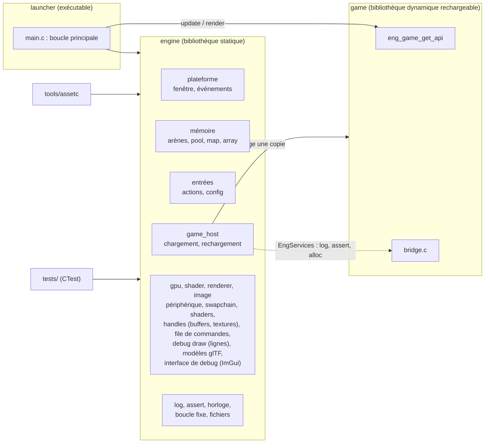

# Architecture

État : fin du jalon M0 (v0.0). Ce document décrit ce qui **existe** ; ce qui est prévu est
signalé comme tel. Les décisions structurantes sont dans [`docs/adr/`](adr/README.md).

## 1. Vue d'ensemble

| Cible | Type | Rôle | Lie |
|---|---|---|---|
| `engine` | bibliothèque statique | tout ce qui est indépendant du jeu | SDL3, cglm, cgltf, stb |
| `launcher` | exécutable | boucle principale, assemble moteur et jeu | `engine` |
| `game` | bibliothèque dynamique | règles et contenu du jeu | **rien** (voir §2) |
| `tools/assetc` | exécutable | cuisson d'assets (M2) | `engine` |
| `tests/*` | exécutables CTest | un exécutable par module | `engine` |

Règle de dépendance : `game` ne dépend d'aucune bibliothèque du projet. Il inclut seulement des
**en-têtes** du moteur (`game_api.h`, `input_state.h`, `log.h`, `assert.h`, `debug_draw.h`).

## 2. Le contrat moteur / jeu

Le jeu ne lie pas le moteur (ADR 0001). Deux objets traversent la frontière, définis dans
`engine/include/engine/game_api.h` :

- `EngServices` : table de fonctions donnée par le moteur au jeu (`log`, `assert_fail`, `alloc`),
  plus un `userdata` à repasser à chaque appel ;
- `EngGameApi` : table d'entrées que le jeu retourne via l'unique symbole exporté
  `eng_game_get_api` (`init`, `reload`, `unload`, `update`, `render`, `shutdown`,
  `state_size`).

`game/src/bridge.c` définit côté jeu `eng_log_write` et `eng_assert_fail` et les relaie vers
`EngServices` : `ENG_LOG_*` et `ENG_ASSERT` s'écrivent donc de la même façon dans le moteur et
dans le jeu. `gm_bind_services` doit être appelé dans `init` **et** `reload`.

Toute évolution du contrat (nouvelle fonction de service, nouvelle entrée) incrémente
`ENG_GAME_API_VERSION` ; l'hôte refuse une bibliothèque d'une autre version.

### Règles du code de jeu (rechargement à chaud)

1. Tout l'état du jeu vit dans le bloc `state` fourni par le moteur (`api->state_size` octets,
   zéros au premier chargement). Pas de variable globale modifiable. Seule exception : le
   pointeur vers `EngServices` de `bridge.c`, reconstruit à chaque chargement et sans état à
   conserver.
2. Aucun pointeur vers le code ou les données de la bibliothèque dans l'état (pointeurs de
   fonction, littéraux de chaîne, adresses de statiques) : utiliser indices, identifiants,
   handles. Les pointeurs vers la mémoire du moteur (arènes) sont sûrs.
3. Changer la **taille** de l'état est détecté (rechargement refusé, relancer). Réordonner des
   champs sans changer la taille **n'est pas détecté** : relancer.
4. Aucun thread du jeu ne survit à un appel.
5. Le jeu n'appelle que les fonctions de `EngServices` : il n'a accès à aucun autre code du moteur
   (voir « Questions ouvertes »).

## 3. Cycle d'une frame

Dans `launcher/src/main.c`, un tour de boucle :

| # | Étape | Remarque |
|---|---|---|
| 1 | `eng_clock_tick` | compteurs entiers haute précision, `dt` |
| 2 | `eng_game_host_poll`, `eng_renderer_update` | le fichier du jeu a-t-il changé ? si oui, rechargement (§6). Un shader `.hlsl` a-t-il changé ? (Debug) si oui, recompilation et nouveau pipeline (`docs/shaders.md`) |
| 3 | `eng_memory_begin_frame` | vide l'arène *frame*, mémorise le compteur d'allocations |
| 4 | `eng_platform_pump` | lit les événements SDL, met à jour les verrous d'entrée |
| 5 | `eng_loop_advance` | accumulateur : combien de pas de simulation (60 Hz fixe, `dt` plafonné à 0,25 s) |
| 6 | pour chaque pas : `eng_input_begin_tick`, puis `game.update(state, input, dt)` | les appuis sont livrés **une fois** par pas |
| 7 | `eng_memory_end_frame` | vérifie qu'aucune allocation n'a eu lieu depuis l'étape 3 |
| 8 | `game.render(state, alpha, &out)`, puis présentation : GPU (`eng_gpu_begin_frame` / `eng_gpu_end_frame`) ou, en repli sans GPU, `eng_platform_present` (affichage logiciel) | `alpha` interpole entre les deux derniers pas ; la scène de démo enregistre ses dessins dans la file du renderer (`eng_renderer_begin_frame`), exécutée par `eng_renderer_end_frame` ; le carré du jeu n'est visible qu'avec `--software` jusqu'à ce que le jeu dessine via le renderer (M1-07) |
| 9 | `ENG_PROF_FRAME` | marqueur de frame Tracy (build de profilage) |

Points à connaître :
- le contrôle de rechargement (étape 2) est hors du compteur d'allocations : c'est un outil de
  développement (accès disque, copie de fichier, compilation des shaders) ;
- `render` et `present` s'exécutent **après** `end_frame` : leurs allocations ne sont **pas**
  comptées aujourd'hui (l'affichage logiciel provisoire en fait 2 par image, mesuré). Le
  compteur couvrira l'image entière avec le rendu GPU (M1) ;
- `update` peut s'exécuter 0, 1 ou plusieurs fois par frame ; il ne doit jamais lire l'horloge :
  seul `dt` fait foi (ce qui rend la simulation reproductible, base du replay de M5).

## 4. Mémoire

Trois arènes linéaires (`EngMemory`), aux durées de vie différentes :

| Arène | Vit | Vidée par | Usage |
|---|---|---|---|
| `permanent` | toute l'exécution | jamais | état du jeu, tables, ressources chargées une fois |
| `level` | une zone / un niveau | `eng_memory_reset_level` | ressources de zone |
| `frame` | une image | automatiquement, étape 3 | travail temporaire d'une image |

Règles :
- **Pas de `malloc`/`free` de la libc** dans `engine/`, `game/`, `launcher/` : interdit par
  `tools/scripts/lint.sh` (recherche de texte dans les fichiers `.c` et `.h`). Les allocations non liées à une arène passent
  par `SDL_malloc`/`SDL_free`.
- **Zéro allocation pendant la boucle de frame** : compteur branché sur
  `SDL_SetMemoryFunctions` (`eng_mem_track_install`, appelé au tout début de `main`). Portée
  exacte : il voit SDL et ce qui passe par `SDL_malloc` ; il ne voit pas un appel direct à la
  libc, d'où la règle lint ci-dessus (ADR 0003).
- Une arène ne se redimensionne pas : elle est remplie puis vidée ; dépasser sa taille retourne
  `NULL` (à traiter) et journalise une erreur.
- En Debug, la mémoire libre d'une arène est « empoisonnée » (ASan) : lire après un reset ou
  au-delà du marqueur est détecté.
- Structures génériques : `ENG_ARRAY(T)` (tableau dynamique), pool à **handles générationnels**
  (un handle périmé est détecté ; génération 0 réservée = handle nul), hashmap à adressage ouvert
  (clés 64 bits). Pool et map prennent leur mémoire dans une arène.
- Les pointeurs vers l'arène *frame* ne doivent jamais être conservés d'une image à l'autre ;
  vers `permanent`, ils peuvent l'être (y compris dans l'état du jeu).

## 5. Threads

État actuel : **tout s'exécute sur le thread principal** (moteur et jeu).

- Le journal est protégé par un mutex : on peut journaliser depuis n'importe quel thread.
- **Rien d'autre n'est thread-safe** : arènes, pool, map, array, entrées, horloge, hôte de
  rechargement.
- Le jeu n'appelle `update`/`render` que depuis le thread principal et ne crée pas de thread
  (règle 4 du §2).
- Le client Tracy (build de profilage) crée ses propres threads ; il n'interagit pas avec le
  reste.
- Règle pour la suite (streaming du monde, M7) : un thread de travail ne touche ni aux arènes,
  ni à l'API du jeu ; il reçoit ses entrées et rend ses résultats par une file de tâches
  dédiée, et c'est le thread principal qui les intègre.

## 6. Rechargement à chaud

`game_host` surveille le fichier de la bibliothèque (date et taille). Quand il change :

1. attend qu'il soit **stable** sur deux contrôles consécutifs (l'éditeur de liens peut encore
   écrire) ;
2. **copie** la bibliothèque sous un nom neuf dans `hot/` et charge la copie (l'original reste
   libre pour le compilateur ; sous Windows une DLL chargée est verrouillée) ;
3. vérifie la version de l'API et la taille de l'état : sinon le rechargement est **refusé**
   et l'ancien code continue ;
4. `ancien.unload(état)`, `nouveau.reload(état, services)`, décharge et supprime l'ancienne copie.

Une version refusée n'est pas réessayée en boucle ; une nouvelle compilation l'est.

Cas particulier : sous Linux, le profileur Tracy rend `dlclose` inopérant. L'hôte s'adapte
(noms de copie uniques dans le processus, copies supprimées à l'arrêt seulement) ; voir
`docs/profiling.md`.

## 7. Entrées, configuration, fichiers

- **Entrées** : le code de jeu ne voit que des *actions* (`EngAction`) et des *axes*
  (`EngAxis`), jamais des touches. Chaque pas reçoit un `EngInputState` : appuyé / maintenu /
  relâché pour les boutons, valeurs pour les axes (zone morte radiale). Les appuis sont
  verrouillés entre deux pas : aucun appui court n'est perdu. La perte de focus relâche tout et libère
  la souris. La molette est cumulée par pas (`EngInputState.wheel`). Caméra libre de debug :
  `docs/camera.md`.
- **Configuration** : `config.ini` à côté de l'exécutable, lu au lancement, valeurs par défaut
  si absent, lignes invalides signalées puis ignorées. Pas de rechargement à chaud.
- **Fichiers** : chemins relatifs à l'exécutable (`SDL_GetBasePath`), lecture entière dans une
  arène, surveillance par (date, taille) avec attente de stabilité.

## 8. Dépendances tierces

| Dépendance | Usage | Intégration |
|---|---|---|
| SDL3 | fenêtre, entrées, fichiers, threads, mémoire | statique, via FetchContent, version figée |
| cglm | mathématiques (via `engine/math.h`, `docs/conventions.md`) | en-têtes seuls |
| cgltf, stb | glTF (`engine/model.c`), images (`engine/image.c`) | en-têtes seuls ; implémentations **uniquement** dans `engine/src/third_party_impl.c` ; cgltf alloue par `SDL_malloc` |
| utest.h | tests | en-tête, option `OW_BUILD_TESTS` |
| Tracy | profilage | optionnel, `OW_PROFILE=ON` |
| Dear ImGui + cimgui | interface de debug (`engine/ui.h`, `docs/debug-ui.md`) | optionnel, `OW_UI=ON` (par défaut) ; commits figés ensemble, cloné à la configuration (~145 Mo), demande un compilateur C++ ; backends SDL3 et SDL_GPU appelés par `engine/src/ui_backend.cpp` |
| SDL_shadercross, DXC, SPIRV-Cross | compilation des shaders HLSL | outil de build (`OW_BUILD_SHADERS`) ; liés au moteur en Debug pour le rechargement à chaud (`OW_SHADER_HOT_RELOAD`) — ADR 0004, `docs/shaders.md` |

Règles (ADR 0002) : versions figées ; le code tiers n'est jamais compilé avec `-Werror` ; une
bibliothèque à en-tête unique est implémentée dans un seul fichier ; `game/` ne voit jamais un
type d'une dépendance tierce.

## 9. Questions ouvertes

- **Structures génériques côté jeu.** `eng_pool_*`, `eng_map_*` et `eng_array_*` sont compilées
  dans `engine` : le jeu, qui ne le lie pas, ne peut pas les appeler aujourd'hui. Option
  recommandée : compiler ces modules **sans état global** (arena, array, pool, map) aussi dans la
  bibliothèque du jeu. À trancher avant que le jeu en ait besoin (M2 ou M4).
- **Zones de profilage côté jeu** : même contrainte ; passer par `EngServices` ou compiler le
  client Tracy dans le jeu. À trancher quand le jeu aura du code à profiler.
- **Détection d'un changement de disposition de l'état** à taille égale (hash de la disposition).
- **Emplacement des assets** : décision en M2.

## 10. Relecture

Document relu à la clôture de M0 (tâche M0-RV). Pour chaque point : vrai / faux / dépassé.
À refaire à chaque jalon qui change le cycle d'une frame (M1 : rendu GPU) ou le modèle de
threads (M7).
