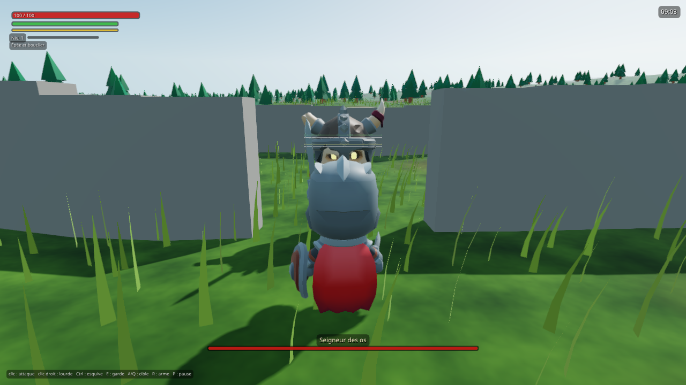

# Combat jouable (`--combat`) — raccord M4 + M5 + M6

Branche la simulation de combat (M5) et l'IA (M6) sur le personnage du mode jouable (M4), dans
l'arène de M4. Code : `launcher/src/play_combat.c`.

```
build/debug/bin/launcher --combat              # jouer (son activé ; --no-audio pour le couper)
build/debug/bin/launcher --combat-autoplay     # un pilote automatique joue (démonstration)
build/debug/bin/launcher --combat-selftest     # sans fenêtre : journalise « AUTOTEST COMBAT : OK »
build/debug/bin/launcher --combat-autoplay --screenshot capture.ppm 120   # image n° 120 en PPM
```

## Sur le terrain procédural (`--terrain`)

```
build/release/bin/assetc heightmap doux.hmap --size 513 --spacing 2 --alt-max 25 --wavelength 500
build/release/bin/launcher --combat --terrain doux.hmap [--grass --placement]
build/debug/bin/launcher --play-terrain-selftest doux.hmap   # « AUTOTEST TERRAIN : OK »
```

Le sol devient le champ de hauteurs (collision Jolt alignée sur le rendu, origine −côté/2) ; le
personnage, le mannequin et le camp sont posés sur le relief (le dessin suit la hauteur sous
chaque combattant). Navigation sur le relief (M6-03, ADR 0027) : la grille de l'IA bloque les pentes
au-delà de 45° (la limite du personnage Jolt) et les petits îlots isolés ; les postes du camp tombés
dans une pente sont déplacés ; un ennemi ne remonte jamais sur une pente (il glisse le long du
bord). Sur un terrain raide le départ du joueur peut encore tomber sur une pente et la caméra se
coller au versant. Les dessins de l'IA (cônes) suivent la hauteur sous le joueur seulement.

```
build/release/bin/assetc heightmap raide.hmap --size 257 --spacing 2 --alt-max 60 --wavelength 100
build/release/bin/launcher --combat-terrain-selftest raide.hmap   # « AUTOTEST CAMP TERRAIN : OK »
```

## Le boss (M6-09, sur un terrain)

Sur un terrain (`--terrain`), une **arène murée** se dresse au sud-est de la clairière : centre
(16, −16), 14 m de côté, murs de pierre de 3 m en segments de 2 m qui suivent le relief, **entrée de
4 m au nord** (côté du départ). Les murs arrêtent le joueur et la caméra (boîtes Jolt), l'IA les
contourne (ils sont dans sa grille). Dedans : le **Seigneur des os** (archétype `boss` de
`assets/combat/enemies.txt`, guerrier squelette 1,45 fois plus grand, à l'espadon), 420 PV :

- attaques légère `boss_l`, lourde `boss_h`, et un **enchaînement scripté** léger, léger, lourd
  (`plan pattern 0 2.8 420 2 LLH`, voir `docs/ai.md`) ;
- sous la moitié de ses PV : phase 2, attaques plus vives (`boss_l2`, `boss_h2`), 25 % plus
  rapide, recharges raccourcies ;
- une barre de vie en bas de l'écran (« Seigneur des os ») tant qu'il combat ou qu'il est
  verrouillé ; « Seigneur des os vaincu ! » ;
- il ne renaît pas une fois vaincu (même après la mort du joueur ou un rechargement : son état est
  dans la sauvegarde) ; s'il tue le joueur, il revient à neuf à son poste.

`--at-boss` (avec `--combat --terrain`) fait commencer la partie 4 m devant l'entrée, pour l'essayer
tout de suite.



Si l'entrée tombe dans une pente infranchissable (relief très raide), le jeu le journalise
(« arène du boss inaccessible sur ce relief ») : la place de l'arène est fixe. Le pilote automatique
(`--combat-autoplay`) préfère le camp et passe par l'entrée pour rejoindre le boss.

## Commandes (en plus de celles de `--play`)

| Action | Clavier / souris | Manette |
|---|---|---|
| Attaque légère (chaîne de 3) | clic gauche | X |
| Attaque lourde | clic droit | gâchette |
| Esquive (sans direction : pas en arrière) | Ctrl gauche | B |
| Garde (maintenir) ; parade = presser au bon moment | E | Y |
| Verrouillage (de nouveau : relâcher) | touche A en AZERTY (Q en QWERTY : même touche physique) | clic du stick droit |
| Changer d'arme (M8-08, dès qu'on en a deux) | R | croix droite |

Pendant une attaque, une esquive ou une réaction, le personnage ne marche pas (le combat décide).
Verrouillé, une attaque se tourne automatiquement vers la cible.

Outils de mise au point (M5-16, M6-10) :

| Touche | Effet |
|---|---|
| F5 | gèle le jeu (simulation, IA, personnage et animations arrêtés ; la caméra aussi) ; de nouveau : reprend |
| F6 | jeu gelé : avance d'UN tick (1/60 s), animations comprises |
| F1 | panneau de debug ; section « Combat » : tick, état de chaque combattant, attaque en cours et sa phase (anticipation / ACTIF / récupération), PV, posture |
| clic gauche dans la vue (F1 ouvert) | sélectionne l'ennemi sous le curseur : son état d'IA (perception, chemin, jeton) dans la section « IA », cercle autour de lui |

## Mode créatif (touche « , »)

La touche qui écrit « , » dans la disposition du clavier (action `creative`, modifiable dans
`config.ini`) bascule le mode créatif : le joueur est **invincible** (ses PV sont remis au maximum
avant chaque pas de simulation), il **vole** (sans gravité ni collision, jamais sous le sol : Espace
monte à 12 m/s, avancer suit le regard, vitesse horizontale x 3) et ses **dégâts ne changent pas**
(mêmes attaques, mêmes valeurs). « MODE CRÉATIF » s'affiche à côté du nom de l'arme. La simulation
de combat est dans le plan : en vol au-dessus d'un ennemi, les coups portent encore. L'autotest du
combat le vérifie (activation, même dégât par coup, PV remis, montée, pas de chute, retour au sol).

## Équipement (M8-08)

Deux armes (`engine/equipment.h`) : **épée et bouclier** (départ : enchaînement de 3 coups, lourde
= estoc) et **espadon** à deux mains (gagné la première fois que le camp est vaincu : « Espadon
obtenu ! ») : `gs_light1` (anticipation 16 ticks, 18 dégâts) et `gs_heavy` (26 ticks, 40 dégâts),
animations `slash_2h` / `chop_2h` calées sur les mêmes instants d'impact que celles du brute (test
de synchronisation). R change d'arme hors attaque, esquive ou réaction ; le chevalier tient alors
l'espadon sans bouclier, le rig suit la nouvelle lame, le HUD affiche l'arme. Sauvegarde : section
EQUI (armes possédées, arme en main). Essai sans finir le camp : `launcher --combat --new-game
--weapon greatsword`.

## Ce qui est à l'écran

- Mannequin en (4, −1), devant le départ : poteau fixe, 1000 PV, se remet à neuf après 3 s sans coup.
- Camp vers (−14, −11) : grunt (rapide, ronde), brute (lent, lourd), archer (portée longue, fuit blessé).
- Arène de M4 en volumes éclairés avec ombres (marches, mur, plateforme, rampe).
- Télégraphe (sans F3) : l'arme d'un ennemi **s'allume en orange** pendant l'anticipation
  (≥ 300 ms), de plus en plus fort jusqu'au coup, puis **en rouge** tant qu'elle peut toucher
  (émissif ajouté au dessin de l'arme, `EngModelDrawOptions.emissive_add` ; le bloom la fait
  rayonner). Traînée blanche derrière la lame pendant une attaque (M5-20).
- Avec F3 : hurtboxes par zone (tête / torse / membres ; gris = intouchable), armes orange puis
  rouges, capsules physiques ; dessinées **par-dessus** les modèles (sinon cachées dans les corps).
- Barres au-dessus des têtes : PV (vert), posture (jaune). Cercle magenta : cible verrouillée.
- Cônes de vision des ennemis (couleur = état : vert ronde, jaune alerte, magenta poursuite,
  rouge engagé, bleu retour, cyan fuite), ligne vers la cible, anneau jaune = jeton d'attaque.
- Étincelles d'impact (particules) ; son des coups (synthétisé).
- Mort du joueur : renaissance au bout de 3 s et camp remis à neuf ; camp vaincu : il réapparaît
  au bout de 10 s.

## Données rechargeables

`assets/combat/attacks.txt` (frame data du joueur et des ennemis) est relu à chaud : enregistre,
l'effet est immédiat (refusé et journalisé si invalide ou si une attaque ennemie descend sous
300 ms ; différé si une attaque est en cours). `assets/combat/enemies.txt` (archétypes) est lu au
lancement. Sans ces fichiers, des valeurs intégrées identiques sont utilisées.

## Ce que l'autotest vérifie (12 mesures ; terrain : 16)

`--combat-terrain-selftest` vérifie en plus le boss (M6-09) : présent dans son arène, accessibilité
de l'entrée bien signalée, contournement du mur sud ; puis un joueur automate entre, verrouille et
frappe : le boss est vaincu (environ 5 100 ticks sur le terrain raide), l'enchaînement léger, léger,
lourd et les attaques de la phase 2 sont vus, et il ne renaît pas quand le joueur meurt.


Dégâts sur le mannequin (10 coups légers = 100), verrouillage puis relâche, esquive (état Dodge,
recul de 3 m), camp : ennemis engagés, au plus 2 attaquants, coups reçus ; puis combat verrouillé
jusqu'à une victoire, toujours au plus 2 attaquants.

## Limites

- ~~Fil de fer seulement~~ : depuis la finition de M4, chevalier et squelettes animés (`docs/characters.md`) ; F3 montre les capsules. L'arène est celle de M4,
  pas la carte procédurale.
- Le personnage physique (Jolt) reste l'autorité de position du joueur : la simulation lui renvoie
  esquive, recul et séparation, bornés à 0,6 m par tick. Les ennemis se déplacent dans la
  simulation (plan), sans physique ni marches.
- Les lignes de l'IA (cônes) sont dessinées à hauteur fixe.
- La traînée est faite de lignes (debug draw), pas encore un ruban texturé. La lueur du télégraphe
  est la même pour toutes les armes (réglée dans `telegraph_glow`, `play_combat.c`).
- Son : vérifié avec le pilote « dummy » chez moi, **jamais écouté** ; latence matérielle non mesurée.
- Ressenti (lisibilité, réactivité) : à juger sur ta machine ; c'est le critère « 2 testeurs » de M5.
- Captures faites chez moi en rendu logiciel (SwiftShader), pas sur un vrai GPU.
