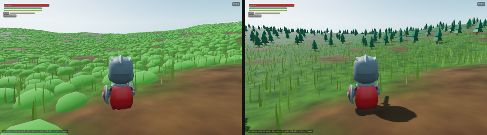

# Placement procédural (M3-08)

## Ce que c'est

Semer des instances (touffes, rochers, cailloux) sur le terrain selon des **règles** : où (pente, altitude, matériau
de la splatmap) et avec quelle densité. Le résultat est un tableau d'`EngInstance` (voir `docs/instancing.md`) : un
seul dessin le rend.

- `engine/placement.h` : `EngPlacementRule`, `eng_placement_vegetation_rule` / `eng_placement_rock_rule`,
  `eng_placement_rule_valid`, `eng_placement_suitability`, `eng_splatmap_weight_at`, `eng_placement_count`,
  `eng_placement_generate`.
- Lanceur : `--placement` (et `--placement-seed N`) : rochers sur la roche, arbres sur l'herbe (B8, voir
  « Modèles du lanceur » ci-dessous).

## Algorithme

Une grille de cellules de `cell_meters` mètres couvre le champ. Chaque cellule propose **un** candidat, à une
position tirée dans la cellule (jitter). Le candidat est accepté avec la probabilité **adéquation** (0 à 1) :

```
adéquation = pente × couche            (0 hors marge, hors bande d'altitude, ou si la roche dépasse rock_weight_max)
pente      = 1 jusqu'à slope_max − slope_falloff, puis 1 − smoothstep jusqu'à 0 à slope_max
couche     = poids bilinéaire de density_layer (si density_layer >= 0 ; 0 si < layer_weight_min), sinon 1
```

La densité moyenne vaut donc `adéquation / cell_meters²` par m² : elle **suit la splatmap** (deux fois moins d'herbe
sur un sol à moitié herbe = deux fois moins de touffes). Au plus une instance par cellule : la densité maximale est
`1 / cell_meters²`, et deux instances ne sont jamais dans la même cellule (pas d'amas). Pour semer plus dense, réduire
la cellule.

- **Pente** : différences centrées de `eng_heightmap_sample` à ± un espacement d'échantillon, au point exact du
  candidat (pas au sommet le plus proche).
- **Altitude** : relative à la plage du champ, bornes incluses.
- **Roche** : `rock_weight_max` < 1 interdit la règle là où le poids de roche dépasse la limite : c'est ce qui garde
  la végétation hors des pentes rocheuses.

### Déterminisme

Le tirage d'une cellule est un hachage pur de (graine, i, j, canal) : sans état et sans ordre. Mêmes entrées (champ,
splatmap, règle, origine) → mêmes instances, **octet pour octet** ; une autre graine → un autre semis. Un candidat
ne dépend pas de ses voisins : changer la règle d'une cellule ne décale pas les autres.

### Mémoire

`eng_placement_generate` compte d'abord (sans stocker), puis alloue exactement `count × 36` octets dans l'arène et
remplit. En cas d'échec (règle invalide, splatmap absente ou de mauvaise taille alors que la règle la demande, arène
trop petite) : `false`, journalisé, `*instances` = NULL, arène restituée. Aucune instance : `true`, NULL, 0.

## Règles par défaut

| | végétation | rochers |
|---|---|---|
| cellule | 2 m | 6 m |
| pente | 28° max, décroissance sur 8° | toutes |
| couche | herbe, poids ≥ 0,2 | roche, poids ≥ 0,35 |
| roche max | 0,15 | sans limite |
| échelle | 0,6 à 1,2 | 0,5 à 2,0 |
| enfoncement | 5 % de l'échelle | 15 % |

La position y est `hauteur du champ − sink × échelle` : l'instance s'enfonce un peu dans le sol et ne flotte pas sur
une pente. La teinte est un gris tiré dans `[tint_min, 255]`.

## Modèles du lanceur (B8)

Jusqu'à la finition, le lanceur dessinait la végétation avec le petit rocher procédural teinté en vert (196 910
« touffes » sur le terrain de la tranche verticale). Désormais :

- rochers : `assets/props/nature/rock_single_B.gltf`, arbres : `tree_single_A.gltf` (KayKit Medieval Hexagon Pack,
  CC0, téléchargés par `tools/scripts/kaykit_nature_prepare.sh`, voir `assets/LICENCES.md`) ;
- la règle de végétation est adaptée à des arbres : cellule de 12 m (forêt claire), échelle 4 à 6 (5 à 7 m de haut) ;
  celle des rochers : échelle 6 à 14 (1,8 à 4 m de large) ;
- en combat (`--combat`), une **clairière** de 45 m de rayon reste vide au centre (apparition du joueur, camp) :
  `eng_instances_clear_disc` (`engine/instancing.h`) retire les instances du disque en gardant l'ordre ;
- arbres et rochers **projettent leur ombre** (cascades sur un terrain, voir `docs/shadows.md`) et la reçoivent ;
- arbres et rochers **arrêtent le joueur et la caméra** : `demo_scene_obstacles` donne une capsule verticale par
  instance (tronc élargi à 0,12 × l'échelle pour que la tête ne traverse pas les branches basses, hauteur 1,1 ×
  l'échelle ; rocher : sphère de 0,13 × l'échelle au sommet de la roche), le lanceur les ajoute à Jolt
  (`play_mode_add_obstacle`, puis `eng_physics_optimize`) : 5 424 capsules sur le terrain de la tranche, coût non
  mesurable (1,1 ms par image avant comme après). Le joueur glisse autour d'un tronc s'il ne le prend pas de face.
  La grille de l'IA (± 30 m) est entièrement dans la clairière : les ennemis ne rencontrent pas d'arbre ;
- si un fichier manque, le lanceur journalise un avertissement et revient au rocher procédural.



## Limites

- L'instance est posée à la hauteur du champ, **sans s'aligner sur la normale** : une touffe sur 25° reste verticale
  (voulu pour de la végétation ; pour des rochers l'enfoncement masque l'écart).
- Pas de distance minimale entre instances de règles différentes : un rocher peut chevaucher une touffe.
- La pente est évaluée à l'échelle d'un échantillon : un relief plus fin que l'espacement du champ n'est pas vu.
- Collision approchée par une capsule par arbre ou rocher : le feuillage haut n'arrête rien (on ne peut pas y
  monter de toute façon) ; les modèles de repli (rocher procédural) n'ont pas de collision. Au-delà de la limite de
  corps de Jolt (10 240), les obstacles restants sont ignorés (un avertissement).
- Un seul modèle d'arbre et un seul de rocher (le pack en a d'autres : `tree_single_B`, `rock_single_A` / `C` sont
  téléchargés mais pas encore utilisés).
- Le débit sur GPU réel n'est pas mesuré ici.

## Tests

- `engine.placement` (18) : règle par défaut valide, chaque champ invalide refusé ; même graine = mêmes octets, autre
  graine = autre semis ; densité 1 = exactement une instance par cellule dans la marge (62 × 62) ; instances valides,
  dans la marge, au sol (à l'enfoncement près) avec une origine monde décalée ; zone raide vide et zone plate plantée
  (pente) ; décroissance lisse (adéquation 0,5 à mi-chemin) ; bande d'altitude respectée, bornes incluses ; densité
  proportionnelle au poids de la splatmap (rapport ≈ 0,5 pour 128/255) et coupure nette sous `layer_weight_min` ;
  aucune végétation sur la roche, rochers seulement sur la roche ; suitability nulle hors champ / marge / NaN ;
  poids bilinéaire ; `count` = `generate`, échecs sans effet sur l'arène ; règle qui ne place rien ; terrain généré
  réel : aucune touffe sur une pente rocheuse (pente ≤ max + 12°, roche ≤ limite, herbe ≥ minimum) ; bornes des
  règles (inclusives / exclusives) ; échelle, cap et teinte tirés sur toute leur plage ; marge inclusive ; espacement
  de 2 m (pente et poids de splatmap en mètres).
- `launcher.terrain` : `--placement` sur un terrain doux de 512 m journalise les nombres (> 0 arbres KayKit), mêmes
  nombres à chaque lancement, aucun dessin rejeté par le renderer (le bug de la première version : instances
  d'arbres jamais envoyées), graine invalide refusée.
- `launcher.combat_terrain_render` : combat en pilote automatique sur ce terrain avec `--placement` : arbres KayKit,
  4 cascades, 60 passes d'ombre, aucun dessin perdu ni rejeté.
- `launcher.play_terrain` : un tronc de 0,6 m à 3 m devant le joueur qui marche dessus 3 s : il ne s'approche jamais
  à moins de 0,85 m de l'axe (mesuré 0,92 ; 0,44 sans la capsule, mutation détectée) ; paramètres invalides refusés.
- `engine.instancing` : `eng_instances_clear_disc` (dedans retirés, bord gardé, ordre conservé, arguments invalides).

## Mutations (vérification des tests)

`engine/src/placement.c` : 270 mutants d'opérateurs au total sur trois passes ; les tests ont été renforcés après
chaque passe (bornes des règles, plage de l'échelle / du cap / de la teinte, espacement ≠ 1 m, pente selon z,
altitude relative avec `altitude_min` ≠ 0, dernière ligne et colonne de la splatmap, validation des entrées).
Survivants restants, tous équivalents ou non observables : bornes de saturation à une valeur identique (`<` / `<=`
d'un clamp), lecture au texel du bord où l'interpolation vaut zéro, signe de la différence centrée (élevée au
carré), constantes internes du hachage (la qualité statistique est vérifiée par la répartition de l'échelle, du cap
et de la teinte), cellules supplémentaires hors du champ (rejetées par la marge), décalage d'une cellule du jitter
(même nombre et même répartition), égalités exactes de flottants (pente = pente max).
