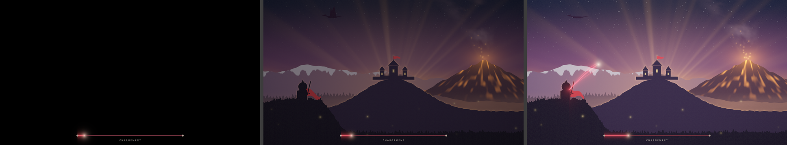

# Écran de chargement animé (2026-11-22)

## Le problème

Entre l'ouverture de la fenêtre et la première image du jeu, il se passe plusieurs secondes de
chargement (éclairage d'ambiance, carte du monde, cellules, personnages). Pendant ce temps la
fenêtre n'était jamais dessinée : sous X11 elle montrait une copie figée de ce qu'elle recouvrait.

## Ce qui est fait

- **Dès que le GPU est prêt**, le fil principal dessine une scène animée, pendant que les étapes
  longues du chargement s'exécutent **dans un fil à part**. La fenêtre vit pendant tout le
  chargement (les événements sont traités : on peut la déplacer, la fermer).
- La scène est un seul shader plein écran, `shaders/splash.frag.hlsl`, sans autre image que le
  titre : l'aube sur la carte du monde (montagnes enneigées à gauche, volcan à droite, château sur
  sa colline au centre), le chevalier sur sa falaise, et le **fil rouge** qui part de son écharpe,
  rejoint le mât du château puis le cratère du volcan (le chemin de l'aventure) en soulignant le
  titre « RED STRINGS ».
- Déroulé : fondu depuis le noir ; le fil se déroule (0,35 à 3,2 s) ; le titre apparaît de gauche à
  droite derrière un éclat (1,1 à 2,6 s) ; puis la scène vit en boucle tant que le chargement dure
  (rayons du soleil, nuages, brume, fumée et braises du volcan, coulées de lave, dragon qui passe,
  herbe, cape et bannière au vent, lucioles, étoiles, reflet qui balaie le titre) ; la corde du bas
  se remplit avec la progression ; à la fin, le soleil éclate, la scène rougit et s'éteint, et le
  menu apparaît en fondu.
- Durée : au moins 3,4 s (le temps que le titre apparaisse) puis 0,9 s de sortie. Une touche ou un
  clic après la première seconde **passe** l'animation dès que le chargement est fini.
- Le titre et la légende sont rasterisés au lancement en **champ de distance**
  (`engine/text_sdf.h`, stb_truetype, police Noto Sans) : nets à toute résolution, et la distance
  sert au halo et à l'apparition.

## Écran d'attente : avant même que le GPU soit prêt (2026-11-22, 20 h)

Retour de Théo : « il y a encore environ 5 secondes de vide au lancement, où il y a mon fond
d'écran au lieu du chargement ».

**Ce qui se passait.** Le journal de son lancement le montre : fenêtre ouverte à 0,43 s, première
image de l'écran de chargement à 3,3 s. Entre les deux, le programme attend le pilote de la carte
graphique. Mesuré sans fenêtre sur sa machine (RTX 5070 portable) : `SDL_CreateGPUDevice` prend
**2,7 s à froid** (la carte dédiée d'un portable dort tant que rien ne s'en sert) et 0,2 s à chaud.
Pendant ce temps la fenêtre, déjà ouverte en plein écran, n'était pas dessinée. S'y ajoutaient
0,9 s de fondu depuis le noir.

**Ce qui est fait.**

- La fenêtre est **peinte par le processeur** dès qu'elle existe (surface logicielle de la fenêtre,
  quelques millisecondes après son ouverture) : noire, puis la **corde de chargement** de la scène y
  apparaît en fondu (0,3 s) et s'anime — les deux chevilles, la corde qui vibre, le nœud lumineux
  qui avance, la légende « CHARGEMENT ».
- Pendant ce temps le pilote démarre **dans un fil à part** (`eng_gpu_create`, la partie longue).
  La fenêtre n'est rattachée au GPU qu'ensuite, depuis le fil principal (`eng_gpu_attach`).
- Quand le GPU prend le relais, la scène apparaît en fondu **derrière** la corde, qui continue au
  même endroit, au même instant de sa vibration et à la même progression : le shader reçoit la
  durée de l'attente (`anim.w`) et ne refait pas le fondu de la corde.
- La corde de l'attente occupe au plus les 10 premiers centièmes de la barre
  (`ENG_BOOT_PROGRESS_END`) et s'en approche sans l'atteindre ; le chargement du jeu reprend là.

Trois captures d'un écran virtuel (pilote vidéo `x11`, démarrage du GPU retardé de 2,5 s) :
l'attente dessinée par le processeur ; 0,35 s plus tard le GPU a pris le relais et la scène
apparaît derrière la corde ; puis la scène éclairée, le fil qui part.

| Module | Rôle |
|---|---|
| `engine/boot_screen.h` | le dessin, pur (ni SDL ni GPU) : la corde avec **les formules du shader**, dans une image XRGB ; seule une bande du bas de l'écran est redessinée (`eng_boot_bounds`) |
| `launcher/src/splash_prelude.c` | `splash_prelude_run` : la surface de la fenêtre, le fil du pilote, la boucle d'images (une toutes les 16 ms) |
| `engine/gpu.h` | `eng_gpu_create` (sans fenêtre, dans le fil) puis `eng_gpu_attach` (fil principal) ; `eng_gpu_init` fait les deux |
| `shaders/splash.frag.hlsl` | `anim.w` : secondes d'attente déjà montrées ; la corde garde son fondu et son temps |

Coût d'une image de l'attente : 3,6 ms en 2560 x 1600 (bande de 1474 x 269 pixels), 1,7 ms en
1080p. La surface utilisée est celle, native, du pilote vidéo (X11 : mémoire partagée), jamais un
moteur de rendu : il faudrait justement le pilote graphique que l'on attend.

**Le relais est vérifié image contre image** (`--splash-shots`) : la dernière image de l'attente
(processeur) et la première image de la scène (GPU, hors écran) sont comparées pour trois durées
d'attente. Mesuré en rendu logiciel, en 1280 x 720 : écart d'au plus 6 niveaux sur 255, et 26
pixels sur 921 600 au-delà de 2 niveaux, tous au bord des lettres de la légende.

`--gpu-delay MS` (développement) retarde le démarrage du pilote : pour voir l'écran d'attente même
quand la carte est chaude. `--no-wait-screen` le retire (la fenêtre attend le GPU sans image, comme
avant) en gardant l'écran de chargement : le repli si le relais posait un souci sur une machine.

## Fils et règles de SDL_GPU

| Fil | Fait |
|---|---|
| principal | la fenêtre, les événements, l'image de la fenêtre (`SDL_WaitAndAcquireGPUSwapchainTexture`), le dessin de l'écran avec ses propres tampons de commandes ; avant le GPU : l'écran d'attente (surface de la fenêtre) |
| pilote graphique | `splash_prelude_run(travail)` : `eng_gpu_create`, et rien d'autre ; il ne touche pas à la fenêtre |
| chargement | `splash_run(travail)` : `eng_renderer_init` + `demo_scene_init` ; `start_world` ; `play_mode_enable_combat` ; chargement des personnages. Il ne fait que créer et remplir des ressources. |

Pendant un `splash_run`, le fil principal ne touche ni au renderer du moteur ni à l'état d'`EngGpu`
(seulement au périphérique et à la fenêtre). L'interface (Dear ImGui), le menu et les options
restent initialisés sur le fil principal, entre deux travaux. Vérifié en Debug (ASan, UBSan,
couches de validation Vulkan) : aucun message.

La progression affichée est une **estimation par étapes** (rendu 50 %, monde 85 %, combat 92 %,
personnages 98 %) qui avance en douceur dans chaque étape : ce n'est pas une mesure exacte.

## Quand l'écran s'affiche

- Par défaut pour une partie lancée à la main.
- **Jamais** pour les lancements automatiques (`--frames`, autotests, mesures) : le chargement y
  est direct, sur le fil principal, exactement comme avant (`splash_run` appelle alors le travail
  sans créer de fil).
- `--no-splash` le retire ; `--splash` le force (tests) ; `--splash-shots DOSSIER` écrit 8 images
  de l'animation en PPM, les mesure (AUTOTEST CHARGEMENT) et quitte.

## La fenêtre est dessinée dès qu'elle apparaît

La fenêtre n'est plus créée cachée (elle l'a été quelques heures, sous X11 et hors plein écran) :
elle apparaît tout de suite et l'écran d'attente la peint aussitôt (ci-dessus). Le plein écran
enregistré dans les options du jeu est demandé **à la création** de la fenêtre : elle apparaît
directement à sa place, au lieu de naître en fenêtre puis de basculer.

L'écran d'attente n'existe qu'avec les pilotes vidéo `x11` et `offscreen` (ceux qui ont été
essayés). Ailleurs (Wayland, Windows) le lancement est celui d'avant : la fenêtre attend le GPU.

## Après le chargement (2026-11-22)

- Vers l'**écran-titre** : la scène ne s'éteint plus. `splash_finish(..., false)` laisse le titre
  apparaître puis rend la main ; l'écran-titre (`docs/title-menu.md`) reprend la même scène au même
  instant, dans la boucle du jeu.
- Vers le jeu directement (`--new-game`) : la sortie d'avant (éclat du soleil, fondu au noir).
- Les ressources (pipeline, image du titre) ne sont plus libérées à la fin du chargement : elles
  servent à l'écran-titre, jusqu'à l'arrêt du jeu (`splash_shutdown`).
- Échap pendant le chargement passe l'animation (il ne ferme plus le jeu).

## Tests

- `engine.text_sdf` (4) : champ de distance, marges, espacement, accents, lecture bilinéaire, refus.
- `engine.boot_screen` (11) : l'image du module comparée à une transcription directe du shader
  (quatre formats d'écran, six instants, avec et sans légende : un niveau d'écart au plus), rien
  d'éclairé hors de la zone annoncée, fondu depuis le noir, corde remplie lumineuse et corde vide
  sombre, nœud à la progression, vibration entre deux bouts fixes, légende, respect du tampon,
  paramètres absurdes, progression qui monte sans atteindre sa limite.
- `launcher.splash` : chargement réel avec l'écran : la fenêtre est peinte avant le GPU (écran
  d'attente), des images sont présentées PENDANT le chargement (quatre travaux dans le fil de
  chargement), puis le jeu tourne, sans erreur.
- `launcher.splash_wait` : pilote retardé de 0,6 s (`--gpu-delay`) : l'attente s'anime pendant
  tout ce temps (des dizaines d'images), la corde avance, puis la scène la reprend.
- `launcher.splash_no_wait` : `--no-wait-screen` : pas d'écran d'attente, le reste inchangé.
- `launcher.splash_shots` : 8 images mesurées : il sort du noir, le fil part puis traverse le
  ciel, le titre apparaît à moitié puis en entier, la corde se remplit, tout s'éteint ; et le
  relais entre l'attente et la scène, image contre image (trois durées d'attente).
- `engine.gpu` : l'initialisation en deux temps donne un GPU qui dessine ; le rattachement refuse
  une fenêtre qui a encore sa surface logicielle. `engine.platform_input` : la fenêtre demandée en
  plein écran l'est dès sa création, à la taille de l'écran.
- À la main, sans fenêtre réelle : le vrai pilote vidéo `x11` sur un serveur X virtuel (Xvfb), avec
  et sans gestionnaire de fenêtres (openbox), captures de l'écran virtuel : la corde dès la
  première capture, la scène qui apparaît derrière elle, le plein écran dès l'ouverture
  (800 x 450 demandés, 1600 x 900 obtenus). Et le lancement tel que le joueur le fait (sans
  `--frames`, plein écran par défaut) : attente, scène, écran-titre, puis fermeture propre.

## Limites (dites clairement)

- **Pas essayé sur un vrai écran** : tout a été vérifié hors écran, en rendu logiciel (lavapipe),
  et sur un serveur X virtuel. Restent à constater sur la machine de Théo : le relais entre la
  surface de la fenêtre et la carte NVIDIA, et le plein écran sous GNOME. En cas de souci :
  `--no-splash` rend le lancement d'avant (sans écran d'attente ni écran de chargement).
- L'écran d'attente ne raccourcit pas le démarrage : la carte graphique met toujours 2,7 s à se
  réveiller. Il occupe ce temps. Le tout premier instant (le programme démarre, 0,4 s avant la
  fenêtre) reste sans image.
- Entre la dernière image de l'attente et la première image du GPU, la corde est figée le temps de
  rattacher la fenêtre et de préparer la scène (environ 0,06 s mesuré en rendu logiciel).
- Au bord des lettres de la légende, quelques pixels peuvent changer d'un ou plusieurs niveaux au
  relais (le GPU ne filtre pas l'image du texte exactement comme le processeur).
- En rendu logiciel, l'animation prend tous les cœurs et ralentit le chargement (35 s au lieu de
  3 s) : c'est propre au rendu logiciel des tests ; sur une carte graphique le shader coûte de
  l'ordre de la milliseconde.
- Quelques étapes courtes restent sur le fil principal (interface, options, pose du décor) : une
  image est présentée entre elles, mais l'animation peut marquer un léger à-coup (mesuré : 102 ms
  au plus en Debug logiciel).
- Pas de son pendant l'écran de chargement.
