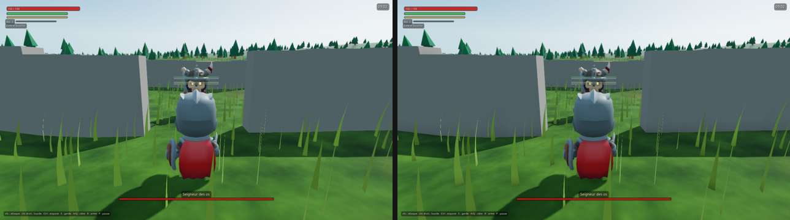

# HDR, tonemapping et gamma (M1-14)

La scène n'est plus dessinée directement dans l'écran : elle l'est en **HDR** (texture RGBA16F,
lumière **linéaire**, valeurs au-delà de 1,0 permises), puis une passe plein écran la ramène à
l'écran avec une exposition, une courbe de tonemapping et l'encodage sRGB. Les types et la
référence CPU sont dans `engine/tonemap.h`.

## Chaîne d'une image

```
passe principale  ──►  texture HDR RGBA16F (taille de la swapchain, profondeur comprise)
passe de résolution ─► swapchain : exposition → opérateur → encodage sRGB   (tonemap.frag.hlsl)
passe overlay      ──►  swapchain : interface de debug, dessinée par-dessus, SANS tonemapping
```

- `EngRendererDesc.hdr = true` met tout en place : `eng_gpu_enable_hdr`, un pipeline `tonemap`
  (shaders `tonemap.vert/frag`), un sampler au plus proche. Les pipelines créés **sans**
  `color_format` dessinent alors en RGBA16F (`eng_renderer_scene_format`).
- La résolution est déclenchée par la **fin de la passe principale** (`EngGpu` appelle la fonction
  installée par `eng_gpu_set_resolve`) : aussi bien quand l'overlay s'ouvre que quand l'image se
  termine. Une image sans aucun dessin est donc quand même résolue (fond uni).
- **Repli** : si les shaders `tonemap.*` manquent ou si le GPU ne sait pas dessiner en RGBA16F,
  un avertissement est journalisé et le renderer continue **sans HDR**, comme avant
  (`eng_renderer_hdr_enabled` = `false`).
- La couleur de fond (`eng_renderer_set_clear_color`) est maintenant une valeur de **scène**
  (linéaire), pas une valeur d'écran : `(0,1 ; 0,1 ; 0,1)` donne un gris visiblement plus clair
  qu'avant (≈ 0,35 une fois encodé en sRGB).

## Calcul

```
rgb    = clamp(hdr, 0, 65504) × 2^EV            exposition en EV : +1 EV double la lumière
rgb    = opérateur(rgb)                         vers [0, 1]
sortie = encodage_sRGB(rgb)                     sauf cible déjà _SRGB (le GPU encode alors)
```

| Opérateur | Courbe |
|---|---|
| `ENG_TONEMAP_NONE` | `saturate` : aucune compression, tout ce qui dépasse 1,0 est écrasé (sert de témoin) |
| `ENG_TONEMAP_ACES` (défaut) | approximation de Narkowicz de ACES filmic : `x(2,51x + 0,03) / (x(2,43x + 0,59) + 0,14)`, par canal |
| `ENG_TONEMAP_AGX` | AgX dans l'implémentation de three.js / Filament : matrices sRGB ↔ Rec.2020 et « inset/outset », log2 sur [−12,47393 ; 4,026069] EV, sigmoïde polynomiale d'ordre 6, linéarisation en 2,2. Sans le « look » optionnel |

- ACES par canal **désature** les couleurs très lumineuses vers le blanc de façon moins douce
  qu'AgX ; AgX place le gris moyen 0,18 à ≈ 0,5 une fois encodé en sRGB (test
  `agx_middle_grey_is_about_half_after_srgb_encoding`). Aucun des deux n'est « le bon » : ils se
  changent en direct dans le panneau (`tonemap : 0 aucun, 1 ACES, 2 AgX`, `exposition (EV)`).
- Entrées : négatif et NaN → 0 ; au-delà de 65504 (plus grand RGBA16F fini) → 65504. Sans ce
  plafond, un débordement `+inf` donnait `inf/inf = NaN` et un pixel **noir** avec ACES (défaut
  trouvé par les tests, corrigé en C et en HLSL).
- Exposition bornée à ±10 EV, valeur non finie → 0 (`eng_tonemap_sanitize`, appliquée par
  `eng_renderer_set_tonemap`, qui copie).

## Gamma et textures

- Tout le calcul de lumière est **linéaire** : les textures de couleur sont déjà créées en
  `ENG_TEXTURE_RGBA8_SRGB` (décodées par le GPU à la lecture, M1-08), les facteurs de matériau glTF
  et les couleurs de lumière sont linéaires. Le seul encodage sRGB est celui de la résolution.
- Le shader encode lui-même quand la cible est `UNORM` (cas de la swapchain en SDR) et laisse le GPU
  encoder quand elle est `*_UNORM_SRGB` (`R8G8B8A8` et `B8G8R8A8`) : jamais de double encodage.
- Ce qui n'a pas été converti : les couleurs **écrites à la main** dans des sommets (cubes de démo,
  lignes de debug) sont lues comme linéaires ; elles passent aussi par l'exposition et le
  tonemapping, donc leur teinte dépend de l'opérateur (une ligne rouge pure (1,0,0) devient environ
  (0,80 ; 0 ; 0) en ACES avant encodage). Un overlay de debug à couleurs exactes demanderait une
  seconde passe après la résolution.

## Post-process : FXAA et bloom (M8-06)

Les deux effets vivent **dans la même passe** que le tonemapping (`tonemap.frag.hlsl`), pour ne pas
ajouter de texture intermédiaire :

- **Bloom** : pour chaque pixel, 16 lectures de la texture HDR sur deux anneaux (3 et 8 pixels) ;
  seule la part **au-dessus de 1** (`max(c - 1, 0)`) contribue, pondérée par `EngTonemap.bloom`
  (0 à 2, borné par `eng_tonemap_sanitize`). Elle est ajoutée **avant** l'exposition et la courbe.
- **FXAA** : variante simple de celle de Lottes, sur la luminance **après** tonemapping : détection
  du contraste local (4 voisins), direction du bord, deux lectures bilinéaires (calculées à la main,
  le sampler étant au plus proche) le long du bord, repli sur la moyenne proche si la lecture large
  sort de la plage de luminance locale. `EngTonemap.fxaa` l'active.
- Par défaut dans `EngTonemap` : désactivés (les tests de valeurs exactes restent exacts). Le
  lanceur les active (FXAA oui, bloom 0,5) ; le menu **Options** du jeu (« Anticrénelage (FXAA) »,
  « Halo lumineux (bloom) ») et le panneau de debug F1 les règlent ; les valeurs sont enregistrées
  dans `options.txt` (`graphics.fxaa`, `graphics.bloom`).
- Coût : 16 lectures (bloom) + 9 à 13 lectures (FXAA) par pixel en plus ; mesuré, voir « Coût par
  effet » ci-dessous. Les voisins de la détection d'arête du FXAA sont lus **sans** bloom (avant :
  64 lectures de plus par pixel, « tout » coûtait 1,81 ms au lieu de 1,01).

## SSAO (finition M8-06)

Occlusion ambiante calculée **dans la même passe** de résolution, depuis la profondeur de la passe
principale :

- la profondeur est créée **échantillonnable** si le format le permet (`EngGpu.depth_sampleable`) et
  **conservée** à la fin de la passe principale quand le HDR est actif
  (`eng_gpu_fill_scene_depth_target` ; non conservée, elle donnait du bruit à la relecture : le défaut
  a été vu en jeu et corrigé avant le commit) ;
- la scène donne la projection de l'image à chaque image (`eng_renderer_set_projection`) : la distance
  se retrouve par z = B / (d + A) ;
- par pixel : normale reconstruite par les voisins les plus proches en profondeur, 12 prises sur un
  disque (angle d'or, tourné par un bruit à gradient entrelacé), rayon en mètres projeté à l'écran
  (2 à 48 pixels), occultation selon l'angle à la normale (seuil 0,15) atténuée au-delà de deux
  rayons ; puis moyenne sur le carré de 2 x 2 pixels par les dérivées fines (quatre rotations : 48
  prises sans passe de flou) ; le ciel n'est jamais assombri ;
- le facteur multiplie l'image **tonemappée** (une fois par pixel, après le FXAA) : simplification,
  il assombrit aussi la lumière directe ;
- réglages : `EngTonemap.ssao` (force 0 à 1, coupé par défaut) et `ssao_radius` (0,1 à 4 m, 0,75) ;
  le lanceur l'active (0,6) ; menu **Options** « Occlusion ambiante (SSAO) », `graphics.ssao` dans
  `options.txt` ; curseurs dans le panneau F1.



## Échelle de résolution (finition M8-06)

`eng_gpu_set_render_scale` (0,5 à 1) : la scène HDR et sa profondeur sont dessinées plus petites,
l'interface reste à pleine taille ; la résolution agrandit la couleur de base en **bilinéaire**
(un deuxième échantillonneur, linéaire, sur la même texture ; le bloom, le FXAA et le SSAO restent
calculés sur la grille de la scène). Sans HDR : sans effet. Menu **Options** « Échelle de résolution »
(50, 75, 100 %), `graphics.render_scale`.

## Coût par effet (finition M8-06)

`launcher --post-bench N` dessine N images par configuration (après 30 de mise en route), sans vsync,
et journalise la durée moyenne d'une image. SDL_GPU n'a pas de requêtes de temps GPU : c'est la durée
de l'image entière, qui mesure le GPU quand c'est lui qui limite. Mesure (RTX 5070 Laptop, plein écran
2560 x 1600, combat devant l'arène du boss sur le terrain de la tranche, herbe et 5 424 arbres,
600 images par configuration, 4 251 attentes du GPU sur 4 411 images : limité par le GPU) :

| Configuration | ms par image | écart à la base |
|---|---|---|
| aucun effet | 5,34 | — |
| FXAA | 5,53 | +0,19 |
| bloom (0,5) | 5,54 | +0,20 |
| SSAO (0,6) | 6,09 | +0,76 |
| FXAA + bloom + SSAO | 6,35 | +1,01 |
| les trois, échelle 75 % | 5,34 | +0,00 |
| les trois, échelle 50 % | 4,63 | −0,71 |

En fenêtre 1280 x 720 (limité par le processeur) les écarts tombent à quelques centièmes de ms.
Test `launcher.post_bench` : la mesure parcourt ses 7 configurations et quitte.

## Vérification

- `tests/test_tonemap.c` (CPU) : valeurs ACES, NONE et sRGB **calculées à la main** ; AgX comparé à
  une implémentation Python indépendante ; monotonie, bornes, entrées non numériques.
- `tests/test_tonemap_gpu.c` : une texture RGBA16F aux valeurs exactes (2 × 2 texels lus au plus
  proche, donc quatre quadrants, aussi pour l'orientation et l'ordre des canaux) est résolue par le
  vrai pipeline vers : RGBA8, RGBA8_SRGB, BGRA8 (avec et sans _SRGB) et **RGBA32F** (comparaison
  au millième, sans arrondi 8 bits, y compris sur le segment linéaire de l'sRGB). La passe principale
  du moteur est vérifiée en relisant la texture HDR (valeurs 4,0 et 0,5 exactes, donc ni écrêtées
  ni arrondies). Chaîne complète : modèle éclairé en PBR (rouge ≈ 3,4, bien au-dessus de 1) → HDR → pixels.
- `tests/test_tonemap_gpu.c`, `fxaa_softens_a_staircase_edge_and_bloom_spreads_a_bright_point` :
  un bord en escalier noir/blanc est adouci par le FXAA (pixels intermédiaires apparus, rien sans
  FXAA) ; un point à 8,0 sur fond noir éclaire ses voisins à 3 et 8 pixels avec bloom et pas sans.
- `tests/test_gpu.c` : ordre résolution → overlay, une seule résolution par image, redimensionnement,
  désactivation ; la profondeur de la scène n'est conservée que si la résolution la relit (mutation
  détectée).
- `tests/test_tonemap_gpu.c`, `ssao_darkens_a_crease_and_leaves_flat_ground_wall_and_sky_alone` :
  profondeur synthétique (caméra à 60°, sol, mur à 6 m, ciel) : le coin s'assombrit (0,044 en moyenne
  sur la bande), le sol proche, le haut du mur et le ciel ne changent pas (0,000) ; rien sans
  profondeur ni avec une projection qui n'est pas une perspective. `tests/test_tonemap.c` : bornes.
- `a_scaled_scene_is_upscaled_bilinearly_and_a_full_one_is_not` : une scène de 32 x 32 résolue dans
  64 x 64 donne des valeurs intermédiaires à la frontière à l'échelle 0,5, aucune à l'échelle 1 ;
  `tests/test_gpu.c` : tailles des cibles à l'échelle (scène et profondeur réduites, écran plein,
  sans effet sans HDR), bornes et arrondi. Mutations détectées.

## Limites connues

- Rendu sur la vraie fenêtre non vérifié par lecture de pixels (la swapchain ne se relit pas) : la
  résolution est vérifiée vers des textures, et l'enchaînement sur la swapchain par compteurs.
- Pas d'auto-exposition : l'exposition est un réglage manuel.
- Bloom approché en une passe (16 lectures, rayon fixe en pixels) : pas de chaîne de flous
  sous-échantillonnés, donc halo court et pas de flou large sur les très grandes sources.
- FXAA simplifié (pas la version 3.11 complète avec recherche des extrémités du bord) : adoucit les
  escaliers mais moins bien qu'un FXAA complet ou un TAA.
- SSAO en une passe : pas de flou bilatéral (seulement la moyenne 2 x 2), appliqué à l'image
  tonemappée (il assombrit aussi le soleil direct), halos autour des objets fins de premier plan
  (herbe devant un mur) ; profondeur standard (pas inversée) : au-delà de quelques centaines de
  mètres la précision baisse. Coût mesuré : voir `docs/devlog/m8-revue.md`.
- Pas de dithering : une dégradé très lent peut montrer des bandes en 8 bits.
- AgX sans « look » ; ACES par canal (pas la chaîne complète AP1/RRT/ODT).
- Un `EngRenderer` HDR consomme une texture RGBA16F supplémentaire (8 octets par pixel, soit 16 Mio
  en 1920 × 1080) et une passe plein écran de plus.
- Le repli sans HDR (échec de `eng_gpu_enable_hdr` sur un GPU sans RGBA16F) n'est pas couvert par un
  test : aucun GPU de test ne refuse ce format. Seul le repli « shaders absents » l'est.
