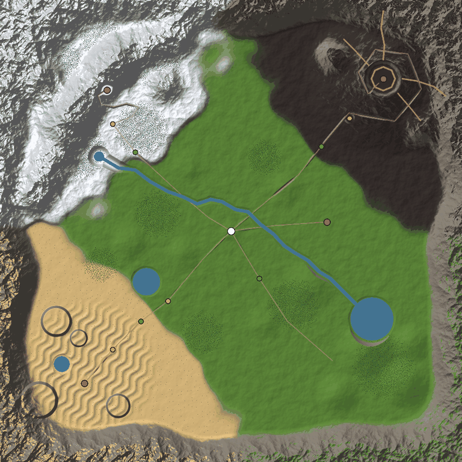

# Carte du monde (dessinée à la main)

Demande de Théo du 2026-11-21 : une grande carte unique, **toujours la même**, dans l'esprit des
mondes ouverts : une grande plaine au centre, le château de départ sur une petite colline d'où l'on
voit presque toute la carte, et les autres régions autour, à portée de vue.

La carte est décrite dans [`assets/world/carte.txt`](../assets/world/carte.txt). Le moteur la lit
(`engine/world_map.h`), puis trame une fois au chargement le relief et les régions (environ 1 à
2 s pour 4 km × 4 km à 4 m). Rien n'est tiré au hasard : le seul bruit est un détail de surface à
graine fixe, identique à chaque lancement.



*Aperçu vu de dessus (nord en haut) : plaine au centre et château de départ (blanc), montagne
enneigée au nord-ouest, désert au sud-ouest, volcan au nord-est, collines au sud-est, falaises sur
le pourtour. Zones : vert facile, orange dur, rouge boss. Lignes beiges : chemins.*

## Voir la carte

```bash
build/debug/bin/carte assets/world/carte.txt apercu.ppm            # aperçu 1024 x 1024
build/debug/bin/carte assets/world/carte.txt apercu.ppm 256 -1300 -1350 50 10   # + altitudes
```

L'outil affiche aussi la pente la plus forte de chaque chemin et l'altitude de chaque zone. Avec
`x0 z0 pas n`, il imprime une grille d'altitudes pour placer les lacets d'un chemin.

## Repère

Mètres ; x vers l'est, z vers le **sud** (le nord est en haut de l'aperçu) ; le château de départ
en (0, 0). La carte couvre [-côté/2 ; côté/2] ; au-delà, le relief du bord est prolongé.

## Format de `carte.txt`

Une instruction par ligne, `#` commence un commentaire. Les erreurs donnent leur numéro de ligne.

| Instruction | Effet |
|---|---|
| `monde côté espacement` | taille de la carte et pas du relief (côté multiple de l'espacement, au plus 4097 échantillons) |
| `eau niveau` | niveau de l'eau (lacs, rivières) |
| `bordure début hauteur` | falaises du pourtour, à partir de `début` m du centre (norme « carré arrondi ») |
| `depart x z` | point de départ du joueur |
| `region biome x z portée` | graine d'une région (`plaine`, `montagne`, `desert`, `volcan`) ; frontières déformées et fondues sur ~10 % de la portée |
| `colline x z rayon hauteur [plateau]` | bosse arrondie, sommet plat de rayon `plateau` |
| `montagne x z rayon hauteur` | pic aux arêtes irrégulières |
| `crete largeur hauteur x z x z ...` | chaîne le long d'une ligne |
| `volcan x z rayon hauteur rayon_cratère profondeur` | cône, cratère à fond plat |
| `plateau x z rayon hauteur` | sommet plat, flancs raides (mesa) |
| `dunes x z rayon amplitude longueur_onde direction_deg` | vagues de sable |
| `aplanir x z rayon [hauteur]` | aire plane (château, camps, arènes) ; sans hauteur : au niveau du sol en son centre |
| `chemin largeur x z x z ...` | route : pente linéaire entre ses sommets, au plus 30 % (garde-fou), extrémités au sol |
| `lac x z rayon profondeur` | creusé sous le niveau de l'eau, berges douces |
| `riviere largeur profondeur x z ...` | lit creusé le long d'une ligne |
| `lave largeur x z ...` | coulée de lave (sillon de 1,5 m), jamais sur un chemin |
| `foret essence x z rayon espacement` | forêt (`chene`, `sapin`, `acacia`) : grille fixe décalée, lisière moins dense |
| `arbres_epars essence biome espacement [groupe]` | objets épars partout où le biome domine : arbres (`chene`, `sapin`, `acacia`), buissons (`buisson`, `buisson_neige`, `buisson_sec`) ou `rocher` ; `groupe` (1 à 4, 1 par défaut) : jusqu'à ce nombre de pieds par emplacement, à moins de 7 m les uns des autres |
| `zone biome facile\|dur\|boss x z` | place d'une zone de combat |
| `meute x z` | une meute de petits monstres à farmer (cinq osselets) : ceux du biome qui domine à cet endroit ; au plus 96 |

Ordre de construction : régions et relief de base des biomes, formes en relief, bordure ; aires
aplanies ; chemins ; lacs et rivières ; lave. Une aire aplanie placée après une colline aplanit
donc la colline.

**Ordre des lignes d'arbres.** Le placement d'une ligne `foret` ou `arbres_epars` dépend de son
rang parmi les formes du fichier : une nouvelle ligne s'ajoute APRÈS les lignes d'arbres
existantes (une ligne insérée au milieu déplacerait les arbres des lignes suivantes).

## Dans le jeu (`--world`)

- **Relief** : les cellules du monde ouvert (256 m, un sommet tous les 4 m) lisent la carte tramée
  (`EngWorldGen.map`) ; plus de rochers, d'arbres ni de camps procéduraux.
- **Sol à six matières** (`eng_biome_splat6`) : herbe, roche, terre, neige, puis sable et lave dans
  une seconde carte de poids (emplacements 9 à 11 après la carte d'ombre, `terrain.frag`). Plaine :
  herbe ; montagne : neige ; désert : sable ; volcan : basalte sombre et cendre ; les chemins en
  terre battue ; la lave rayonne (émissive, visible la nuit).
- **Arbres** (`eng_worldmap_trees`, `launcher/src/world_trees.c`) : chênes (forêts de la plaine),
  sapins enneigés (forêts de la montagne), acacias épars dans le désert, aucun dans le volcan ;
  environ 12 000 sur la carte avec les arbres isolés. Jamais sur un chemin, dans l'eau, sur la lave, sur une pente de plus
  de 35 degrés, à moins de 70 m du départ ni de 32 m d'une zone de combat. Placement fixe : même
  résultat quel que soit le découpage en cellules. Dessin instancié par essence et par cellule ;
  version simplifiée (28 à 64 triangles) au-delà de 220 m ; ombre jusqu'à 200 m ; troncs solides
  (capsules) à moins de 40 m du joueur.
- **Petit décor** (2026-11-22) : entre les forêts, des chênes isolés (seuls, par deux ou par
  trois), des buissons (verts en plaine, enneigés en montagne, secs dans le désert) et quelques
  rochers (gris en plaine, clairs en montagne, ocre au désert, basalte sombre au volcan : la teinte
  suit le biome). Environ 9 700 buissons et 3 500 rochers sur la carte, soit un rocher pour
  90 m x 90 m de plaine. Buissons et rochers ne sont dessinés qu'autour de la caméra (170 m et
  260 m), dans une liste refaite tous les 4 m ; chaque pied grandit de zéro à sa taille en
  approchant : rien n'apparaît d'un coup. Les rochers sont solides, les buissons se traversent.
- **Herbe** (2026-11-22, `eng_worldmap_grass`, `launcher/src/world_grass.c`) : des touffes de six
  brins animées par le vent (`engine/grass.h`), toujours aux mêmes endroits (grille fixe du monde),
  en deux semis autour de la caméra : dense de près (une touffe tous les 0,45 m, jusqu'à 22 m),
  clairsemé et plus haut au loin (tous les 1,3 m, jusqu'à 46 m). Elles rapetissent puis
  disparaissent avec la distance dans le shader. Seulement dans la plaine ; pas sur les chemins, la
  roche (pente de plus de 0,6), dans l'eau, sur la lave ni sous les murs du décor ; des taches
  d'herbe haute plus jaune et d'herbe rase.
- **Eau** (2026-11-22, `eng_worldmap_water`, `launcher/src/world_water.c`) : la surface des lacs
  et de la rivière (un maillage des cellules mouillées, profondeur signée par sommet : le shader
  d'eau du moteur efface ce qui dépasse du relief), visible de près comme de loin. Le joueur
  traverse à gué : un fond physique à 0,7 m sous la surface (de l'eau jusqu'à la taille), et il y
  marche à 60 % de sa vitesse.
- **Lave** (2026-11-22) : elle brûle. Les pieds dans la lave, le joueur perd 6 % de ses PV (au
  moins 4) toutes les 20 ticks (un tiers de seconde) : environ 5 secondes pour mourir. Rien en mode
  créatif ni pendant une esquive. S'il y meurt, il renaît au dernier endroit sûr (au sol, hors de
  la lave), pas au château.
- **Ennemis et arbres** (2026-11-22, `engine/ai_avoid.h`, idée de Théo) : les troncs et les
  rochers à moins de 48 m du camp sont donnés aux ennemis. À moins de 1 m d'un obstacle, la part
  de leur direction qui va vers lui diminue (rien à 1 m, tout au contact) et devient un pas de
  côté : ils contournent ; au contact, ils s'éloignent d'au moins 1 m ; ils ne sont jamais dans un
  tronc.
- **Vue lointaine** (`launcher/src/world_far.c`) : toute la carte, un sommet tous les 32 m, en
  morceaux de 256 m dessinés là où la cellule détaillée n'est pas chargée ; plan lointain 6 km,
  brouillard 0,00035 /m : depuis la colline on voit les montagnes, le désert et le volcan.
- **Départ** : au château de départ, sur la colline (0, 0) : remparts de 2,4 m (on voit par-dessus),
  une porte sur chaque côté, donjon, bivouac. `--at-zone N` place le joueur sur le chemin depuis
  le château, 20 m avant la zone (34 m avant un boss, 150 m avant le dragon, qui est colossal).
- **Zones** : positions lues dans la carte (`eng_worldmap_zones`), le reste (noms, PV, butin) dans
  `engine/map_zones`.
- **Meutes** (2026-11-22, soir ; demande de Théo : « plus de petits mobs, pour les farmer et
  monter de niveau ») : 63 meutes posées dans toute la carte (26 en plaine, 11 en montagne, 15 au
  désert, 11 au volcan), une ligne `meute x z` chacune (`eng_worldmap_packs`). Voir
  [world-streaming.md](world-streaming.md#meutes-de-petits-monstres). `--at-pack N` commence 20 m
  avant la meute N (0 : la première ligne `meute` du fichier).

**Poser une meute.** Les règles sont écrites dans `carte.txt` et vérifiées par le test
`engine.world_map` (qui lit la vraie carte et nomme la meute fautive) : au sec (pas d'eau à moins
de 25 m, pas de lave), sur un terrain praticable (moins de 14 m de dénivelé dans un disque de
20 m), pas au milieu d'un chemin, à plus de 150 m du château de départ, et sans recouvrir la portée
d'une autre meute (170 m entre deux meutes) ni celle d'une zone (195 m ; 505 m de l'antre du
dragon). Le biome n'est pas écrit : déplacer la ligne suffit.

Modèles : `tools/scripts/arbres_make.py` (chêne, acacia, buissons et rocher originaux, sapin
enneigé tiré du sapin KayKit CC0) ; voir `assets/LICENCES.md`.

Essayer : `--at-pos X Z` place le joueur à ce point de la carte (par exemple `--at-pos 1250 780`
au milieu du grand lac, `--at-pos 330 -30` au bord de la rivière).

## État

Fait : carte, relief, matières, arbres, vue lointaine, château de départ, zones, eau (à gué), lave
qui brûle, petit décor (arbres isolés, buissons, rochers), herbe, ennemis qui évitent les arbres,
meutes de petits monstres.
Limites : pas de nage ni de pont (tous les cours d'eau se traversent à gué) ; l'herbe ne pousse que
dans la plaine et ne se couche pas sous les pas ; les ennemis évitent les troncs un par un (pas de
calcul de chemin à travers une forêt dense).
