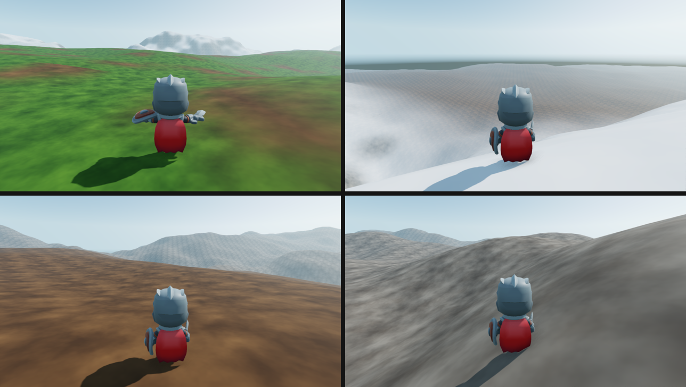
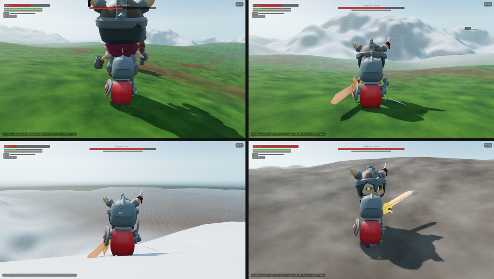
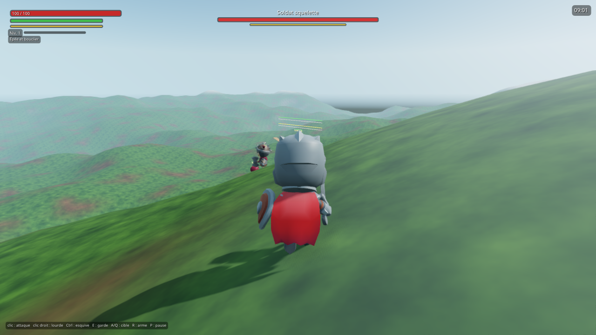

# Monde ouvert (M7) — partition, streaming, origine flottante, persistance, LOD

Modules CPU testés (`test_world_stream`, `test_world_ai`, `test_world_lod`, `test_jobs`, benchmark
`launcher --world-bench`) et, depuis la finition, le **monde rendu et jouable** (`launcher --world`,
section suivante).

## Le monde rendu (`--world`) — `launcher/src/world_view.c`

```
build/release/bin/launcher --world [GRAINE]                       # jouer (ZQSD, souris, F1...)
build/release/bin/launcher --world 7 --world-autopilot 100 --frames 9900   # traversée mesurée
```

- Streaming : rayon de 2 cellules (5 x 5 = 25 cellules de 256 m, 1,28 km de côté), chargées dans
  des jobs (4 workers) ; un emplacement de rendu par cellule prête.
- Rendu : chaque cellule devient un maillage de terrain (65 x 65 sommets, le shader triplanaire et
  les couches de M3, une splatmap de 65 x 65 par cellule) envoyé au GPU par la file d'uploads à
  budget (64 Kio par image : une cellule par image au plus, les plus proches d'abord), éliminé par
  le frustum. Les normales des sommets de BORD sont recalculées avec le bruit du générateur, de
  part et d'autre de la frontière : deux cellules voisines ont exactement les mêmes normales, sans
  couture d'éclairage. Toutes les cellules quantifient leurs hauteurs sur la même plage (même
  échantillon 16 bits au bord : ni fissure ni marche).
- Physique (M7-11) : un corps Jolt « champ de hauteurs » par cellule envoyée, retiré au
  déchargement ; recréé au nouvel endroit quand l'origine flottante saute.
- Origine flottante (M7-10) : recentrage au-delà de 512 m ; le personnage, la caméra et les corps
  des cellules sont décalés ensemble.
- Ombres : 4 cascades jusqu'à 160 m dans un atlas de 4096² (voir M7-09).
- Chargement initial bloquant : les 9 cellules autour du joueur (110 ms sur le RTX 5070), puis le
  personnage est posé sur le relief.
- Mesures journalisées à l'arrêt (« MONDE : ... ») : distance, temps d'image (moyenne, pire, p99,
  images > 25 ms), envois (pire temps par étape : maillage, splatmap, GPU, Jolt), corps Jolt,
  recentrages ; « MONDE : joueur au sol » ou « TROU sous le joueur ».

Mesures (RTX 5070 Laptop, Release, 2026-11-19 ; détail dans `docs/devlog/perf-materiel.md`) :

| Traversée | Images | Moyenne | p99 | Pire | > 25 ms |
|---|---|---|---|---|---|
| 6 km à 100 m/s, vsync 165 Hz, ombre unique | 9 869 | — | < 11 ms | 16,6 ms (un envoi) | 0 |
| 6 km à 100 m/s, vsync, 4 cascades | 9 869 | — | < 11 ms | 25,4 ms (sans envoi ni recentrage, CPU 0,2 ms) | 1 |
| 3,1 km à 100 m/s, sans vsync, 1080p, 4 cascades | 19 969 | 1,57 ms | < 5 ms | 15,9 ms (un envoi) | 0 |

Limites : pas encore d'objets (rochers, arbres, camps des cellules) ni d'ennemis dans le monde ;
LOD discret par cellule (section M7-05) ; un envoi de
cellule coûte ~1 ms en régime, mais jusqu'à 15 ms parfois (création des ressources GPU), sur le
thread principal ; recréer les 25 corps Jolt au recentrage (au lieu de les déplacer).

## Cellules (M7-01) — `world_cell`

- Grille infinie de cellules de **256 m** ; la cellule (cx, cz) couvre x ∈ [256·cx ; 256·(cx+1)[.
- Relief : 65 × 65 hauteurs, une tous les 4 m, **bords partagés** avec les voisines (égalité au bit
  près, testée). Bruit OpenSimplex2 fractal évalué à la coordonnée monde : une cellule est une
  fonction pure de (graine, cx, cz).
- Objets : rochers (rayon 0,6 à 2 m), arbres (0,4 m), un camp sur ~1 cellule sur 4 (au centre).
- Mémoire : 17 Ko par cellule ; 64 emplacements préalloués = **1,1 Mo** fixes pour le streaming.

### Format « RSCL » v1 (petit-boutiste)

| Octets | Contenu |
|---|---|
| 0–3 | `RSCL` |
| 4–7 | version (1) |
| 8–11 / 12–15 | cx / cz (int32) |
| 16–19 | résolution (65) |
| 20–23 | nombre d'objets n (≤ 48) |
| 24 … | 65 × 65 float32, ligne par ligne (z puis x) |
| puis n × 21 | type (u8), x, z, y, cap, échelle (float32) |

Taille exacte obligatoire ; mauvaise signature, version, résolution, type d'objet ou hauteur non
finie : refusé. Un fichier `cell_X_Z.rscl` dans le dossier du monde **remplace** la génération
(cellule éditée) ; sinon la cellule est générée.

## Jobs (M7-02) — `jobs`

Pool de threads SDL, file FIFO bornée (1024), compteurs atomiques C11, dépendance « après tel
compteur ». Le thread qui attend exécute des jobs. Vérifié sous ThreadSanitizer :
`tools/scripts/tsan-jobs.sh` (jobs + streaming ; « TSAN JOBS : OK »).

## Biomes de la grande carte — `biome`

Demande de Théo (2026-11-20) : une carte « façon Zelda » où quatre biomes s'enchaînent depuis le camp
de réveil. `engine/biome.h` : bandes de 800 m le long de +X (plaine, montagne enneigée, désert,
volcan ; la plaine couvre aussi tout ce qui est derrière le départ, le volcan tout ce qui est
au-delà), frontière ondulée (± 70 m selon z) et fondue sur 160 m. Fonction pure de la position
monde : pas de couture entre cellules.

- **Relief** : l'altitude du générateur est multipliée par l'échelle du biome (plaine 0,45, montagne
  1,8, désert 0,35, volcan 1,2), fondue aux frontières (`eng_world_gen_height`, la même valeur dans
  les cellules, la physique et les normales de bord).
- **Matières** : la splatmap de chaque cellule est transformée texel par texel (`eng_biome_splat`) :
  jamais de neige en plaine, neige en montagne, terre (sable) au désert, roche au volcan.
- **Arbres** : en plaine seulement.
- `EngWorldGen.biomes` est désactivé par défaut (le monde d'avant, au bit près : les tests de hash
  ne changent pas) ; le lanceur l'active dans `--world`.
- Tests : `engine.biome` (6 : biome pur au centre de chaque bande, somme 1, fondu monotone,
  ondulation, carte désactivée ou invalide, échelle, matières) ; `world_cell.biomes_keep_seams...`
  (bords de cellules voisines égaux au bit près à cheval sur une frontière, sommets = hauteur du
  générateur, arbres en plaine seulement ; mutation détectée).



Limites : le désert et le volcan n'ont pas encore leur teinte (sable brun, roche grise) ni de lave ;
pas de décor propre à chaque biome.

## Zones d'ennemis de la grande carte — `map_zones`

Dans chaque biome, le long du chemin (+X) : une zone de **farm facile**, une zone de **farm dure**,
puis une zone de **boss** (`engine/map_zones.h`, 12 zones). Les ennemis sont les archétypes du jeu
mis à l'échelle par la zone :

| Biome | Facile (3 ennemis) | Dur (2 ennemis, 2 fois plus grands) | Boss | Dégâts |
|---|---|---|---|---|
| Plaine | 30 PV (3 coups au niveau 1) | 60 PV (6 coups) | 200 PV (20 coups) | x 1 |
| Montagne | 55 PV | 110 PV | 360 PV | x 1,5 |
| Désert | 95 PV | 190 PV | 620 PV | x 2,2 |
| Volcan | 150 PV | 300 PV | 1 000 PV | x 3 |

- Le joueur se réveille dans un **camp sans ennemis** (le mannequin d'entraînement y reste).
- Le lanceur charge la zone la plus proche à moins de 110 m (`play_combat_load_zone` : ennemis, PV,
  dégâts, taille, grille de navigation reconstruite autour de la zone sur le relief chargé) ; il ne
  change pas de zone en plein combat, sauf si le joueur est déjà à plus de 150 m de l'ancienne.
- Rien n'est verrouillé : on peut aller droit au volcan, à ses risques.
- Un **boss de zone** ne réapparaît pas ; sa victoire donne un palier de butin (1 à 4) ; les zones de
  farm réapparaissent 10 s après avoir été vidées. Le nom de la zone s'affiche à son chargement.
- `--at-zone N` (0 à 11) fait commencer 20 m avant la zone N. Le pilote automatique suit le chemin
  quand il n'a personne à combattre.
- Tests : `engine.map_zones` (ordre, bande de chaque zone, 3 / 6 / 20 coups en plaine, difficulté
  croissante, zone la plus proche) ; `launcher.world_combat` (départ devant la zone 0 : elle se
  charge, ses ennemis s'engagent) ; `launcher.world_combat_shift` (traversée : zones 0, 1, 2 chargées
  dans l'ordre, camp en place après recentrage).



Limites : les boss sont encore le même guerrier squelette (« Seigneur des os ») avec plus de PV ;
pas encore de butin réel, de château ni de décor de zone ; boss vaincus oubliés au redémarrage.

## Streaming (M7-03) — `world_stream`

Carré de (2r+1)² cellules autour du joueur (r = 2 : 25 cellules, 1,3 km de côté). Chaque image :
récolte des jobs finis, libération au-delà de r + 1 (hystérésis : un va-et-vient sur une frontière
ne recharge rien), au plus 4 nouvelles demandes, les plus proches d'abord. Chargement (lecture de
fichier ou génération) **dans un job** : le thread principal ne fait que de la comptabilité.

**Écart** : le tracker prévoit l'API d'E/S asynchrone de SDL3 ; la lecture se fait ici avec
`SDL_LoadFile` **dans un thread de travail**, ce qui ne bloque pas non plus l'image.

## Uploads étalés (M7-04) — `upload_queue`

Budget d'octets par image, plus proches d'abord, une demande plus grosse que le budget passe seule,
annulation si la cellule est déchargée avant l'upload. Branché au rendu du monde (`--world`) : la
cellule est envoyée au GPU quand la file la donne.

## LOD du terrain (M7-05) — `terrain_lod`

Sélection CDLOD sur quadtree (8 km : 166 nœuds, 0,25 % des triangles de la pleine résolution à
1 m) ; couverture exacte ; voisins à au plus un niveau d'écart ; facteur de morph. Cette sélection
n'est pas utilisée au rendu. **Au rendu (finition)**, chaque cellule du monde a 3 niveaux discrets
(`eng_terrain_build_lod` : un échantillon sur 1, 2 ou 4, soit des quads de 4, 8 et 16 m) dans un même
tampon d'index, choisis par la distance caméra → centre de cellule (360 m et 720 m, hystérésis de
10 % via `eng_mesh_lod_select`) ; une **jupe** de 6 m sous le bord de chaque niveau bouche les
fentes entre deux cellules de niveaux différents (jonctions en T) ; la passe d'ombre dessine le même
niveau. Mesure : 13 cellules dessinées → 56 320 triangles au lieu de 106 496 à pleine résolution.
Test : `eng_terrain.lod_levels_skip_vertices_and_a_skirt_hangs_under_the_border` (mutation « pas
ignoré » détectée). **Écart** : pas de morph CDLOD (le passage d'un niveau à l'autre se fait d'un
coup, à plus de 360 m dans le brouillard) ; une cellule entière change de niveau.

## LOD des meshes (M7-06) — `mesh_lod`

Regroupement de sommets sur grille (sphère : 32 768 → 7 874 triangles, erreur ≤ une case) ;
sélection avec hystérésis (pas de clignotement sur un seuil). **Écart** : pas de meshoptimizer
(indisponible hors ligne) ; pas encore appelé par le cooker.

## Ombres en cascade (M7-09) — `csm`

2 à 4 cascades (découpage pratique), sphère englobante par tranche indépendante de l'orientation
(tourner la tête ne change pas la taille des texels), centre aligné sur les texels (avancer de 3 mm
ne déplace l'ombre que d'un nombre entier de texels). **Dans les shaders** depuis la finition :
les cascades sont rangées dans un atlas 2 x 2 (une seule texture, cascade k dans le quart k) ; la
passe d'ombre exécute chaque groupe de commandes dans sa tuile (`EngDrawCmd.shadow_tile`,
viewport et scissor réduits) ; `model.frag` et `terrain.frag` prennent, pour chaque pixel, la
cascade la plus fine qui le contient (marge du PCF comprise), avec les mêmes biais que la carte
unique à la taille de texel de la cascade. Test : `shadow_gpu.each_quarter_of_the_cascade_atlas_
gives_the_shadow_of_the_single_map` (même résultat que la carte unique dans chaque quart ;
mutations « quart toujours 0 » et « tuile ignorée » détectées). Utilisé en mode monde (4 cascades
jusqu'à 160 m) ; l'arène et le terrain de M3 gardent la carte unique. Limites : pas de fondu entre
cascades (changement net), projeteurs hors de la sphère d'une cascade non pris en compte (un relief
haut derrière la sphère ne projette pas d'ombre).

## Origine flottante (M7-10) — `world_origin`

Positions monde en double, locales en float = monde − origine ; recentrage sur un coin de cellule
au-delà de 512 m. À 10 km : erreur de quelques micromètres contre 0,4 mm sans recentrage. Chaque
système ajoute `shift` à ses positions locales (démontré pour la simulation de combat et l'IA).

## Physique et navigation par cellule (M7-11) — `ai_area`

Fenêtre de navigation de 64 m autour du joueur, obstacles tirés des cellules prêtes, reconstruite
quand le joueur s'éloigne de 16 m ou que des cellules arrivent. Un ennemi suit le joueur sur
225 m, à travers 2 frontières de cellule et 2 recentrages d'origine, sans jamais décrocher de plus
de 6 m ni entrer dans un obstacle. Jolt est découpé par cellule dans le monde rendu (un champ de
hauteurs par cellule, ajouté et retiré avec elle).

**Ennemis dans le monde rendu (finition M7)** : `launcher --world [GRAINE] --combat` (ou
`--combat-autoplay`) pose le camp de 3 squelettes et le mannequin près du départ (camp ancré en
(112, 112) du monde, à 24 m), avec le HUD, les menus et le combat complet ; pas de boss ni d'arène
dans le monde. La simulation de combat vit dans le repère local : `play_combat_shift` décale
combattants, postes, rondes, chemins, mémoire des ennemis et grille de navigation ; elle sert à
poser le camp au départ et, à chaque recentrage de l'origine flottante, à le garder à sa place
dans le monde (`play_mode_origin_shift`). Le lanceur le contrôle à chaque recentrage (« le camp
reste en place », ERREUR s'il a bougé de plus de 5 cm). La grille de navigation du camp reste la
fenêtre fixe de 60 m du mode combat, pentes prises sur le relief chargé au lancement : elle n'est
pas (encore) la fenêtre mobile de `ai_area`.



Limites : un seul camp, fixe ; loin du camp ses cellules sont déchargées (les ennemis ne sont plus
dessinés à leur hauteur, ils attendent) ; la sauvegarde note des positions locales : elle n'est
fiable dans le monde que tant que l'origine n'a pas été recentrée.

## Persistance (M7-12) — `world_state`

Par cellule : objets retirés (masque 64 bits), camps vaincus ; table fixe de 4096 cellules ;
sauvegarde texte ; un chargement invalide laisse l'état vide (jamais à moitié).
